# Adaptive, Error-Controlled Time Integration for Tensorial POD-Galerkin Models

## 1. Abstract

The previous study found that a reduced integrating-factor RK4 (IF-RK4) with a stability-based step failed
an accuracy criterion on the steepest test cases at POD rank r = 16, and that Radau was the fastest robust
integrator when the reduced diffusion is stiff. This study diagnoses that failure, adds error-controlled
explicit, integrating-factor and exponential integrators, and compares them with the earlier fixed-step
methods and Radau at matched accuracy, under a protocol fixed before any held-out data were used.

* **Failure mechanism.** The fixed-step IF-RK4 failure is excessive temporal truncation error from an
  accuracy-blind (CFL) step; instability, implementation error, floating point and snapshot misalignment
  are ruled out by direct tests. Lawson-type stiff order reduction exists but is negligible in absolute terms.
* **Stiffness.** The reduced Laplacian L is symmetric (normal) with spectral radius 8.2e3, 5.8e4, 3.9e5 for
  r = 8, 16, 32 (nu rho up to 3.9e4). The full Jacobian is nonnormal (Henrici departure up to 0.84): its
  spectral abscissa is negative (at most -0.21) but its numerical abscissa reaches +1.84, and the frozen
  linearisation amplifies perturbations transiently by up to 1.94.
* **Robustness.** With settings frozen on validation plus a new stress-validation set (target / 2 margin),
  **every eligible frozen configuration met its time-error target on every case** of both held-out sets
  (the original test set and a fresh, pre-committed holdout of 50 cases).
* **Efficiency at matched accuracy** (pre-registered comparison, two runs): the preferred integrator
  depends on rank and target. r = 8: fixed-step IF-RK4 at 1e-4, Radau at 1e-6 (Radau and RK45 tie at
  1e-8 on the holdout). r = 16: Radau (a tie with the adaptive Lawson method at 1e-4 on the holdout).
  r = 32: Radau at 1e-4; the new **adaptive Lawson integrating-factor Dormand-Prince 5(4) is faster than
  Radau at 1e-6 (by 4% to 30%) and 1e-8 (by 1.5x to 1.8x)** in both runs on both held-out sets. Explicit
  adaptive RK45 / DOP853 are stability-limited at r = 32 (about 4e4 evaluations at every tolerance, 23 to
  125 times slower than the fastest method). The analytic Jacobian gives Radau no consistent advantage over finite differences.
* **Total accuracy is set by the POD basis**, not the integrator, once the time error is below it; on the
  fresh holdout the POD error is larger than on the original test set (r = 16: mean 1.7e-5 vs 7.7e-7).

Results: `report/adaptive_integrators/`; plan, written before any new integrator was run:
`report/adaptive_integrators/PLAN.md`. Numbers from NumPy 1.26.4 / SciPy 1.13.1 on an Apple M3 Pro.

## 2. Motivation

The verified results of PR #3 (tensorial POD) and PR #4 (spatial convergence, Cole-Hopf reference) are
unchanged; this study builds on their tensorial ROM at N = 2048. PR #4 left two open points: the reduced
IF-RK4 (cheapest) failed its accuracy test on cases steeper than any validation case, and its validation
split did not contain such cases. Six questions follow: can adaptive integration control the temporal
error (RQ1), can adaptive integrating-factor or exponential methods beat Radau at matched accuracy (RQ2),
are they reliable on the steepest cases (RQ3), how does the choice depend on rank (RQ4), how do the reduced
spectra drive solver behaviour (RQ5), and do settings chosen on validation data generalize (RQ6).

## 3. Mathematical formulation

Periodic viscous Burgers u_t + u u_x = nu u_xx on [0, 2 pi), u0 = A sin x, A in [0.5, 2], nu in [0.01, 0.1],
T = 1, outputs at t_j = j/19. POD (rank r) of the 200 historical training trajectories at N = 2048:

    da/dt = nu L a + Q(a, a),      L = Phi^T D2 Phi,   Q_ijk = phi_i^T G(phi_j phi_k)

(the repository's convention: nu is outside L). Verified properties (Stage 1): L symmetric to 1e-15,
negative definite, spectrum in [-rho, -1]; Q symmetric in (j, k); all POD modes have zero mean, so the
reconstructed mean is zero; Phi orthonormal in the grid norm, so coefficient errors equal discrete field
errors.

**Jacobian.** J(a) = nu L + sum_k (Q_ijk + Q_ikj) a_k = nu L + 2 sum_k Q_ijk a_k (Q is jk-symmetric);
agreement with a complex-step derivative 1.6e-16 (exact up to rounding for a polynomial right-hand side).

**Integrating factor.** With a(t) = e^{nu L t} v(t), dv/dt = e^{-nu L t} Q(e^{nu L t} v, e^{nu L t} v). Taken
globally this is unusable here: e^{nu rho t} exceeds the double-precision range (e^709) at t = 1 for every
r = 16 and r = 32 case tested. Resetting the frame each step (v defined on [t_n, t_n + h]) and writing the
Runge-Kutta stages in the physical variable gives

    Y_i = e^{D c_i h} b_n + h sum_{j<i} a_ij e^{D (c_i - c_j) h} N(Y_j),
    b_{n+1} = e^{D h} b_n + h sum_j b_j e^{D (1 - c_j) h} N(Y_j),

in the eigen-coordinates b = V^T a of L = V Lambda V^T (D = nu Lambda). All exponents are <= 0 because
c_j <= c_i for Dormand-Prince, so nothing overflows. Since L is symmetric, V is orthogonal and the
exponentials are diagonal; if L were not symmetric the code raises and the general path (below) applies.

**Exponential integrator.** Krogstad's ETD-RK4 uses phi_1, phi_2, phi_3 of h D and h D / 2,
phi_0(z) = e^z, phi_{k+1}(z) = (phi_k(z) - 1/k!) / z. The recurrence cancels catastrophically near 0; for
|z| < 1 a Taylor series (25 terms) is used. For general matrices phi_1..phi_k(A) come from one exponential
of the block matrix [[A, I, 0, ..], [0, 0, I, ..], ..] (no division by eigenvalues; verified on a nonnormal
Jordan block).

**Error norm and control.** On the physical coefficients:
err = sqrt(mean((e_i / (atol + rtol max(|a_i^n|, |a_i^{n+1}|)))^2)), accepted iff err <= 1, step factor
min(5, max(0.2, 0.9 err^{-1/5})); atol = 1e-3 rtol max|a0|. Lawson DP5(4) uses its embedded 4th-order
estimate (mapped back to a); ETD-RK4 uses step doubling, (y_{h/2,h/2} - y_h) / (2^4 - 1). A local tolerance
does not bound the global error; the global error is measured (Sections 6, 10).

## 4. Existing integration methods and the IF-RK4 failure

Baselines (unchanged): B1 reduced-CFL RK4 and B2 reduced IF-RK4 (fixed steps, `src/reduced_timestep.py`),
B3 Radau with the analytic Jacobian (scipy). New in this study: B3fd (Radau with scipy's finite-difference
Jacobian), E1 RK45, E2 DOP853, X1 adaptive Lawson IF-DP5(4), X2 Krogstad ETD-RK4 with step doubling.
Exponential Rosenbrock methods were not selected: they need phi-functions of the full Jacobian at every step
and address no separate question here; BDF was not added (Radau is the implicit baseline).

**Why B2 failed (Stage 1, `if_failure_run1.json`).** Reproduced exactly (r = 16: 1.15e-5 vs P0 2.64e-6 on
test 5; 5.14e-6 vs 1.22e-6 on test 33).

| mechanism | evidence | verdict |
|---|---|---|
| instability | errors fall monotonically under refinement (9.2e-6, 1.2e-6, 1.0e-7, 7.6e-9 on test 5), all finite, no energy increase | ruled out |
| implementation | converges to an independent RK4 reference (self-check <= 2e-14) at observed orders 3.0, 3.5, 3.8 | ruled out |
| floating point | machine-epsilon perturbation of a0 changes the result by <= 2e-16 | ruled out |
| snapshot alignment | output indices exact multiples of n/19; only the reported time accumulates rounding (<= 1.1e-13) | ruled out |
| **truncation error from an accuracy-blind step** | the CFL step does not shrink with front steepness; the time error at that step is 9.2e-6 (test 5) vs 1.5e-7 on the steepest validation case; the r = 16 margin (1.05 x P0 + 1e-6) is tight because the ROM error is about 1e-6 | **cause** |
| Lawson stiff order reduction | observed orders 1.5 to 2.2 on the smoothest case, error in stiff modes, but <= 2e-9 in absolute terms; on the failed cases 9% to 15% of the error is in stiff modes | secondary |

## 5. Reduced-system stiffness (`stiffness_run1.json`, Figures 1 to 3)

| r | rho(L) | nu rho, nu in [0.01, 0.1] | max rho(J) | max spectral abscissa | max numerical abscissa | max Henrici departure of J | max transient amplification | min frozen RK4 step |
|---|---|---|---|---|---|---|---|---|
| 8 | 8.2e3 | 82 to 822 | 816 | -0.21 | +1.84 | 0.84 | 1.94 | 3.4e-3 |
| 16 | 5.8e4 | 577 to 5767 | 5734 | -0.41 | +1.84 | 0.69 | 1.94 | 4.9e-4 |
| 32 | 3.9e5 | 3931 to 39311 | 39091 | -0.45 | +1.84 | 0.36 | 1.94 | 7e-5 |

(Validation and stress-validation reference trajectories, 20 snapshots each.) L itself is normal; the
nonnormality comes from the nonlinear part, which matters most at r = 8 (its norm reaches 1.16 times the
diffusion part's) and least at r = 32 (0.18). The positive numerical abscissa appears before and during
front formation, largest on the stress cases (Figure 2). **These are properties of the frozen linearisation:
negative eigenvalues do not prove nonlinear stability, and the observed transient amplification is not a
bound on the nonlinear dynamics.** The explicit stability limit falls roughly like 1/(nu rho), which is why
explicit methods become stability-limited at r = 32.

## 6. Adaptive explicit methods (`explore_run1.json`, Figures 4 to 8)

RK45 and DOP853 reach every target, but as stiffness grows their cost stops depending on the tolerance: at
r = 32 they need about 44500 (RK45) and 39800 (DOP853) RHS evaluations at every rtol from 1e-4 to 1e-10
(validation + stress means), against about 200 to 1800 for Radau. Their step sizes chatter at the stability
limit (Figure 8). At r = 8 they are competitive (RK45 ties Radau at 1e-8 on the holdout in run 2).

**Error-control reliability** (max global time error / rtol over validation + stress): Radau 0.003 to 0.006,
RK45 0.002 to 0.03, adaptive Lawson 0.003 to 0.06, step-doubling ETD 0.01 to 0.38 (less conservative at tight
tolerances), DOP853 0.06 to 1.3, and **28 at r = 32 with rtol 1e-10**: tightening DOP853's tolerance there
increased the error (2.8e-9 vs 7.1e-10 at 1e-8), consistent with rounding accumulated over about 4e4
stability-limited steps. No frozen setting was affected.

## 7. Integrating-factor and exponential methods

**Adaptive Lawson IF-DP5(4) (X1).** 6 RHS evaluations per attempted step (FSAL); about 2% of attempted
steps rejected on average (up to 15% on one trajectory, r = 32, rtol 1e-4); about 400, 1000 and 2700 RHS evaluations for rtol 1e-4,
1e-6, 1e-8 at every rank: its cost is essentially independent of rho(L), because the stiff linear part is
integrated exactly. Its steps follow the physics (larger early, smaller once the front forms; Figure 8).

**Krogstad ETD-RK4 with step doubling (X2).** Also rank-independent in evaluations (about 400, 850, 2150), but
step doubling costs three steps (12 evaluations) per accepted step, and its error estimate becomes less
conservative at tight tolerances. It was never the fastest method at any target.

**Matrix-function costs** (Figure 13): one-time eigen-preparation (eigendecomposition of L and the tensor
transform) 0.07 / 0.21 / 1.3 ms for r = 8 / 16 / 32 (single measurements; 0.9 / 0.2 / 3.9 ms inside the final
runs); phi_1..phi_3 of a diagonal argument about 0.1 ms per new step size; the general block-matrix route
0.12 / 0.16 / 508 ms, so the eigenbasis is essential at r = 32. Per-trajectory setup (new nu) about 2 to 3 us.

**Overhead of error control.** Per RHS evaluation X1 costs 13.5 / 7.6 / 20 us (r = 8 / 16 / 32) against 3.9 /
4.5 / 12 us for the fixed-step IF-RK4 (stage exponentials, error norm and control logic in Python): 1.6 to 3.5
times more per evaluation. Error control pays off when it cuts the number of evaluations by more than that:
at r = 16 and target 1e-6, X1 needs about 1000 evaluations, the fixed-step IF-RK4 meeting the same target
about 3600.

## 8. Experimental methodology

**Data sets** (fixed in PLAN.md before any new run): POD from the 200 training trajectories; method
selection on the 40 original validation cases plus a new **stress-validation grid** A in {1.5, 1.75, 2.0} x
nu in {0.010, 0.0125, 0.015, 0.0175, 0.020} (the steep corner, defined by the front-width scale nu / A, not by
test errors); evaluation on the 40 original test cases (**not fully independent**: their failures motivated
this study and they were used in Stage 1) and a **fresh holdout** of 40 cases from U(0.5, 2) x U(0.01, 0.1)
(`default_rng(300000)`) plus 10 steep cases from U(1.5, 2) x U(0.010, 0.020) (`default_rng(300001)`), drawn
only after the selection was committed (`selection_frozen.json`, commit 5ec6cc2).

**References.** Time error: the same reduced ODE by classical RK4 with 4 times the default step count
(self-check against 8 times: <= 3.2e-14 at every rank). Total error: the Cole-Hopf solution of PR #4
(uncertainty <= 2.2e-11 on the original test cases; for the new cases the same evaluation is used without a
separate FOM check). Errors below about 1e-11 are not resolved.

**Selection rule.** For each method, rank and target tau in {1e-4, 1e-6, 1e-8}: the loosest tolerance (or
largest step for B1, B2) whose maximum time error over validation + stress-validation is <= tau / 2.

**Timing.** For each held-out case all frozen configurations of a rank timed round-robin in one loop
(5 repetitions after a warm-up); two runs, each started at a 1-minute load average below 4; the benchmark
itself then raised the load (multithreaded Accelerate BLAS/LAPACK in Radau and the matrix operations; load
average 20 to 35 during the runs, recorded in the JSON files). End to end = projection + integration +
reconstruction; reconstruction of the 20 snapshots 56 to 141 us, projection 9 to 14 us.

## 9. Validation results

Stress-validation exposed what validation alone missed: the fixed-step IF-RK4 at r = 16 has a maximum time
error of 1.5e-7 on validation but 6.0e-5 on stress-validation (400 times larger), so its frozen settings use
2 to 4 times smaller steps than validation alone would have chosen. In `selection_frozen.json` the
fixed-step IF-RK4 is not eligible for 1e-8 at r = 8 and 16 (no tested step reaches 5e-9); every other method
has a qualifying setting for every target.

## 10. Held-out results (`final_run1.json`, `final_run2.json`, `compare_final.json`)

**Reliability.** Every eligible frozen configuration met its target on every case of both held-out sets; the
closest call is a held-out maximum time error of 0.40 times its target (fixed-step IF-RK4, r = 8, target 1e-4,
holdout). The validation + stress maxima are **not** upper bounds for the held-out sets: in 21 of the 120
configuration x set combinations the held-out maximum exceeds it, once by more than a factor 2 (2.41,
DOP853 rtol 1e-10 at r = 8 on the test set); the target / 2 margin and the conservative error-to-tolerance
ratios kept every frozen choice within its target (Figure 14). This is evidence of generalization for this
parameter box, not a guarantee.

**Pre-registered matched-accuracy comparison.** Each method is represented only by its setting frozen for
that target; listed are those meeting the target (maximum time error on the set <= target), with median
end-to-end milliseconds in run 1 / run 2.

| r | set | target | frozen setting per method that meets it: median ms run 1 / run 2 (fastest first, up to 4) | fastest run 1 / run 2 | eligible but failed |
|---|---|---|---|---|---|
| 8 | test | 0.0001 | B2 (div1) 1.66 / 1.96; B3 (rtol0.0001) 3.48 / 4.09; B3fd (rtol0.0001) 3.80 / 3.80; B1 (div1) 4.07 / 4.13 | B2 / B2 | none |
| 8 | test | 1e-06 | B3 (rtol0.0001) 3.48 / 4.09; B3fd (rtol0.0001) 3.80 / 3.80; E1 (rtol1e-06) 6.47 / 6.85; B2 (div4) 6.95 / 7.04 | B3 / B3fd | none |
| 8 | test | 1e-08 | B3 (rtol1e-06) 8.81 / 10.15; B3fd (rtol1e-06) 11.68 / 10.93; E1 (rtol1e-08) 11.82 / 12.33; E2 (rtol1e-10) 15.46 / 16.59 | B3 / B3 | none (not eligible: B2) |
| 8 | holdout | 0.0001 | B2 (div1) 1.71 / 1.99; B3 (rtol0.0001) 3.06 / 4.13; B1 (div1) 3.73 / 3.92; B3fd (rtol0.0001) 3.85 / 4.34 | B2 / B2 | none |
| 8 | holdout | 1e-06 | B3 (rtol0.0001) 3.06 / 4.13; B3fd (rtol0.0001) 3.85 / 4.34; E1 (rtol1e-06) 6.56 / 6.28; E2 (rtol1e-06) 6.78 / 7.46 | B3 / B3 | none |
| 8 | holdout | 1e-08 | B3 (rtol1e-06) 10.08 / 11.57; B3fd (rtol1e-06) 11.01 / 13.10; E1 (rtol1e-08) 11.32 / 11.55; E2 (rtol1e-10) 13.83 / 15.60 | B3 / E1 | none (not eligible: B2) |
| 16 | test | 0.0001 | B3 (rtol0.0001) 3.10 / 4.04; B3fd (rtol0.0001) 4.04 / 4.30; X1 (rtol0.0001) 4.43 / 4.12; X2 (rtol0.0001) 6.88 / 7.81 | B3 / B3 | none |
| 16 | test | 1e-06 | B3 (rtol0.0001) 3.10 / 4.04; B3fd (rtol0.0001) 4.04 / 4.30; X1 (rtol1e-06) 8.13 / 7.69; X2 (rtol1e-06) 18.26 / 18.58 | B3 / B3 | none |
| 16 | test | 1e-08 | B3fd (rtol1e-06) 9.13 / 11.03; B3 (rtol1e-06) 10.43 / 10.57; E2 (rtol1e-08) 28.94 / 28.91; X1 (rtol1e-08) 37.63 / 36.36 | B3fd / B3 | none (not eligible: B2) |
| 16 | holdout | 0.0001 | X1 (rtol0.0001) 3.52 / 3.72; B3 (rtol0.0001) 3.81 / 3.88; B3fd (rtol0.0001) 4.41 / 3.88; X2 (rtol0.0001) 5.70 / 6.40 | X1 / X1 | none |
| 16 | holdout | 1e-06 | B3 (rtol0.0001) 3.81 / 3.88; B3fd (rtol0.0001) 4.41 / 3.88; X1 (rtol1e-06) 7.23 / 7.46; X2 (rtol1e-06) 16.85 / 16.76 | B3 / B3 | none |
| 16 | holdout | 1e-08 | B3 (rtol1e-06) 10.39 / 9.86; B3fd (rtol1e-06) 10.81 / 10.62; E2 (rtol1e-08) 27.79 / 28.45; X1 (rtol1e-08) 38.00 / 38.92 | B3 / B3 | none (not eligible: B2) |
| 32 | test | 0.0001 | B3 (rtol0.0001) 6.48 / 6.50; B3fd (rtol0.0001) 7.03 / 8.27; X1 (rtol0.0001) 7.23 / 6.73; X2 (rtol0.0001) 12.04 / 11.46 | B3 / B3 | none |
| 32 | test | 1e-06 | X1 (rtol1e-06) 12.26 / 15.14; B3 (rtol1e-06) 15.93 / 15.70; B3fd (rtol1e-06) 16.77 / 16.68; X2 (rtol1e-06) 31.12 / 32.26 | X1 / X1 | none |
| 32 | test | 1e-08 | X1 (rtol1e-08) 30.39 / 29.86; B3fd (rtol1e-08) 45.42 / 46.42; B3 (rtol1e-08) 47.60 / 51.13; X2 (rtol1e-08) 71.70 / 76.47 | X1 / X1 | none |
| 32 | holdout | 0.0001 | B3 (rtol0.0001) 6.28 / 5.49; X1 (rtol0.0001) 6.96 / 6.92; B3fd (rtol0.0001) 7.07 / 7.68; X2 (rtol0.0001) 8.55 / 9.47 | B3 / B3 | none |
| 32 | holdout | 1e-06 | X1 (rtol1e-06) 12.38 / 12.74; B3 (rtol1e-06) 14.80 / 14.77; B3fd (rtol1e-06) 15.95 / 16.84; X2 (rtol1e-06) 30.07 / 33.11 | X1 / X1 | none |
| 32 | holdout | 1e-08 | X1 (rtol1e-08) 24.82 / 30.97; B3fd (rtol1e-08) 44.08 / 47.71; B3 (rtol1e-08) 44.13 / 48.23; X2 (rtol1e-08) 67.04 / 69.99 | X1 / X1 | none |

Readings (both runs, both held-out sets):
* r = 32: Radau fastest at 1e-4 (by 4% to 26% over adaptive Lawson); **adaptive Lawson fastest at 1e-6
  (by 4% to 30% over Radau) and at 1e-8 (by 1.5x to 1.8x)**.
* r = 16: Radau fastest at 1e-6 and 1e-8; at 1e-4 Radau on the test set and adaptive Lawson on the holdout
  (3.5 / 3.7 vs 3.8 / 3.9 ms: within run-to-run variation, a tie).
* r = 8: fixed-step IF-RK4 fastest at 1e-4 (1.7 to 2.0 ms); Radau at 1e-6; at 1e-8 Radau, with RK45 tied on the
  holdout in run 2 (11.55 vs 11.57 ms).
* Explicit adaptive methods at r = 32 are 23 to 125 times slower than the fastest method meeting the same target.
* Radau with the analytic vs the finite-difference Jacobian: no consistent difference (either can be faster by
  up to about 20% from run to run); scipy's nfev does not include the finite-difference calls.

## 11. Accuracy-runtime comparisons (Figures 6, 12)

Figure 6 shows the validation Pareto fronts (single runs); Figure 12 the fastest frozen setting per method
versus rank on the holdout. The exponential and implicit methods' cost is nearly independent of rank; the
fixed-step and explicit ones grow with rho(L).

## 12. Physical diagnostics

For every frozen configuration on both held-out sets: no energy increase between snapshots; mean below
1.5e-11 (the r = 32 modes carry about 2e-8 mean from the SVD); max|u| / max|u0| at most 1.003 (r = 8, the
same for every integrator, so a basis effect). The reduced continuous-time ODE is energy-dissipative only up
to the small aliasing term identified in PR #3 (not enforced); time integration added no spurious growth.

**Total error and the POD floor.** Once the time error is below the POD error every integrator gives the
same total error against Cole-Hopf (Figure 10). The time-converged ROM's error, test / holdout: r = 8 6.0e-4 /
1.8e-3 (max 1.6e-3 / 1.8e-2), r = 16 7.7e-7 / 1.7e-5 (max 2.6e-6 / 3.9e-4), r = 32 4.4e-11 / 1.4e-8 (max 8.6e-10 /
4.0e-7). The holdout's steep sub-box samples the corner more densely than the training data, and the POD basis
generalizes less well there: a 1e-6 time-error target at r = 16 is then irrelevant to total accuracy on those
cases. At r = 32 on the original test set the ROM error is near the reference resolution limit.

## 13. Limitations

* One problem (1D Burgers), one parameter box, POD at N = 2048, ranks 8, 16, 32.
* The original test set is not independent for this study; the fresh holdout is.
* Local error control does not guarantee global accuracy; the observed global / local ratios are empirical,
  and DOP853 violated its tolerance at r = 32, rtol 1e-10.
* Stability statements are empirical (no non-finite or growing trajectory among the frozen runs); the Jacobian
  diagnostics describe frozen linearisations only.
* Timing: one Apple M3 Pro; Python-level control logic penalises the new methods per evaluation; the benchmark
  ran at a load average of 20 to 35, largely from its own multithreaded linear algebra; differences below
  about 20% are not stable between runs.
* The new exponential methods are reference implementations in NumPy, not optimized solvers.
* NumPy 2 was used only for the test suite.

## 14. Conclusions

* **Fastest integrator at each target:** r = 8: fixed-step IF-RK4 (1e-4), Radau (1e-6, 1e-8; RK45 tied once).
  r = 16: Radau (1e-6, 1e-8), Radau or adaptive Lawson (1e-4, a tie). r = 32: Radau (1e-4), adaptive Lawson
  (1e-6, 1e-8).
* **Most reliable on steep cases:** every frozen configuration met its target on all steep held-out cases; the
  fixed-step IF-RK4 is reliable only with the smaller steps chosen on stress-validation and is not eligible for
  1e-8 at r = 8 and 16.
* **Does adaptive integrating-factor integration outperform Radau?** Only at the stiffest rank and the tighter
  targets: at r = 32, by 1.5x to 1.8x at 1e-8 and by 4% to 30% at 1e-6. At r = 8 and 16 Radau remains faster at
  1e-6 and 1e-8. *Established for this machine and implementation.*
* **Does the analytic Jacobian improve Radau?** No consistent effect.
* **Rank dependence:** fixed-step and explicit methods degrade as rho(L) grows; Radau and the exponential
  methods are nearly rank-independent, and adaptive Lawson overtakes Radau only at r = 32.
* **Overhead of error control:** 1.6 to 3.5 times more cost per evaluation than the fixed-step IF-RK4, and about
  2% rejected steps on average (up to 15% on one trajectory); worth it when the target is tight or the step must adapt to the front.
* **Where fixed-step methods remain preferable:** the fixed-step IF-RK4 at r = 8 and target 1e-4 (fastest
  overall, 1.7 to 2.0 ms), with its stress-validated step.
* **RQ1 to RQ6:** the adaptive methods controlled the temporal error on every held-out case (RQ1); adaptive
  integrating-factor integration beats Radau at matched accuracy only at r = 32 for 1e-6 and 1e-8 (RQ2); all
  frozen methods were accurate on the steep cases (RQ3); the preferred integrator moves from fixed-step
  IF-RK4 / Radau at low rank to adaptive Lawson at high rank (RQ4); explicit methods are limited by
  nu rho(L), exponential ones are not, and the Jacobian's nonnormality caused no failures (RQ5); settings chosen
  on validation plus stress-validation met their targets on both held-out sets, although held-out maxima
  exceeded validation maxima in 21 of 120 combinations (by up to 2.4x), so the margin, not the validation
  maxima themselves, carried the guarantee in practice; validation alone had not sufficed in PR #4 (RQ6).
* **Hypotheses not tested:** a compiled implementation would change the per-evaluation overhead and probably
  the rankings at r <= 16; a basis trained with more steep-corner samples would lower the holdout POD error.

**Recommendation for the next phase.** Reduce the POD error in the steep corner (targeted or adaptive
sampling of training parameters, or local bases), since it now dominates total error. For time integration,
use Radau at r <= 16 and the adaptive Lawson method at r = 32 for tight targets.

## 15. Figures (`report/adaptive_integrators/figures/`)

| | |
|---|---|
| 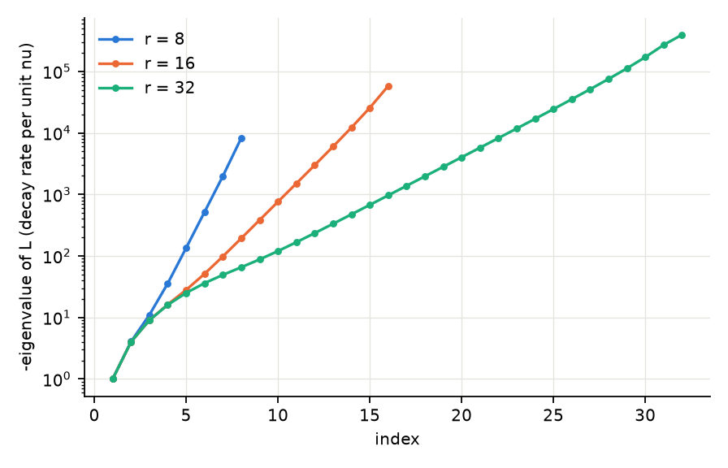 1. Spectrum of L. | 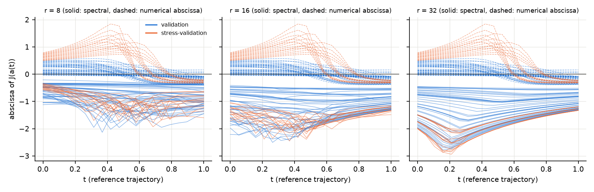 2. Jacobian spectral / numerical abscissae. |
| 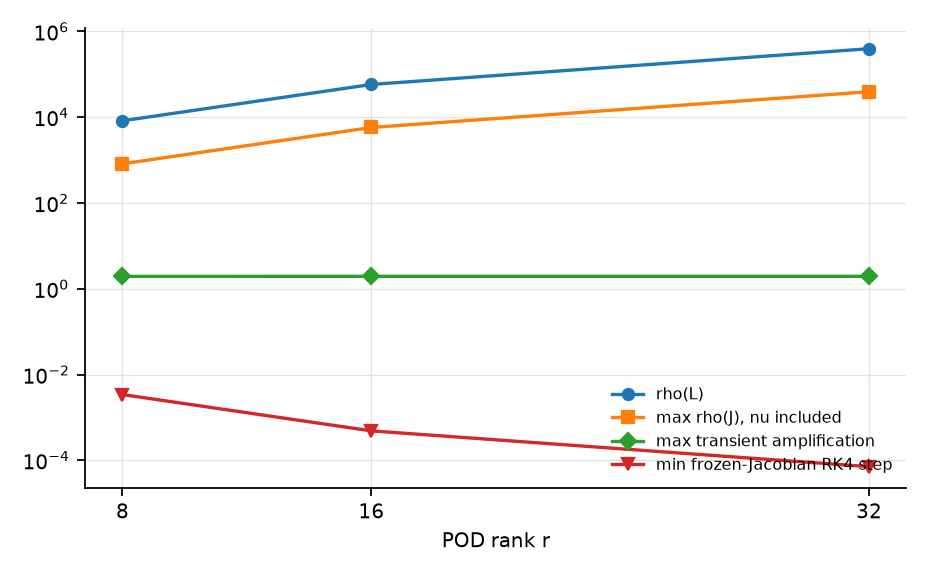 3. Stiffness indicators vs rank. | 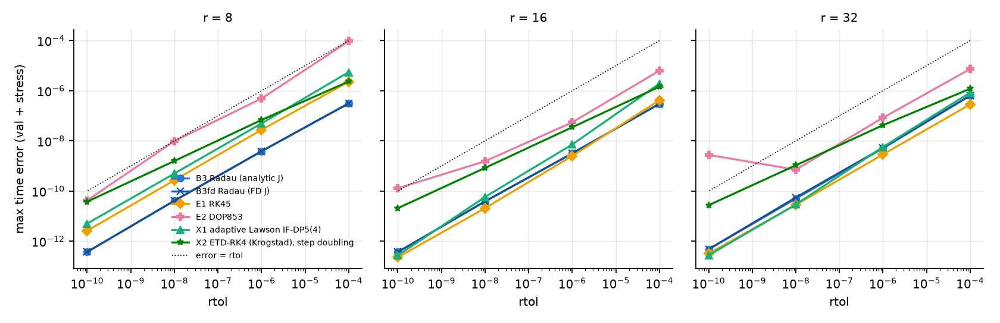 4. Time error vs rtol. |
| 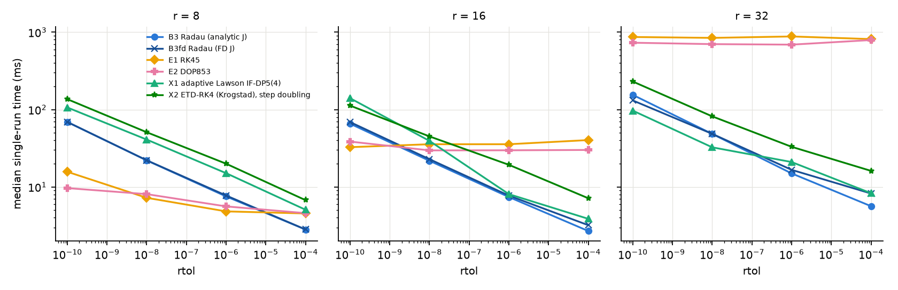 5. Runtime vs rtol (single runs). | 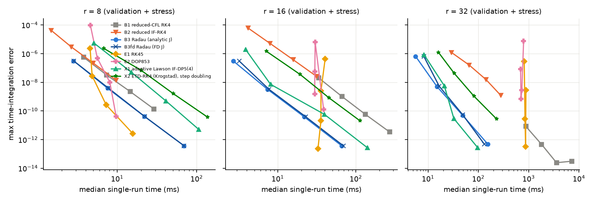 6. Accuracy-runtime Pareto (validation). |
| 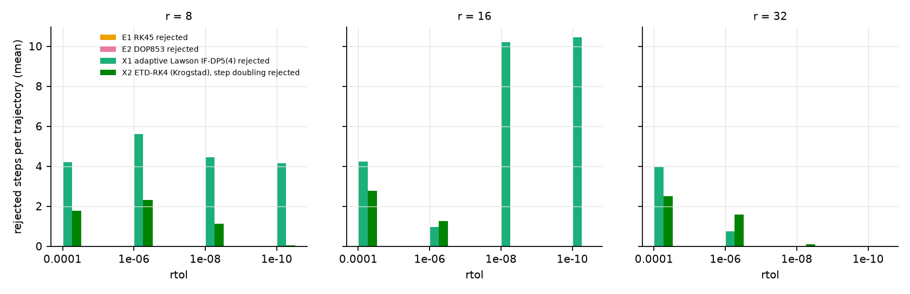 7. Rejected steps. | 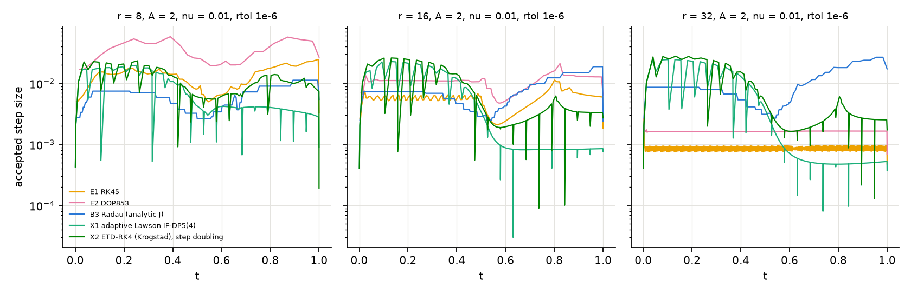 8. Step-size evolution (stress case). |
| 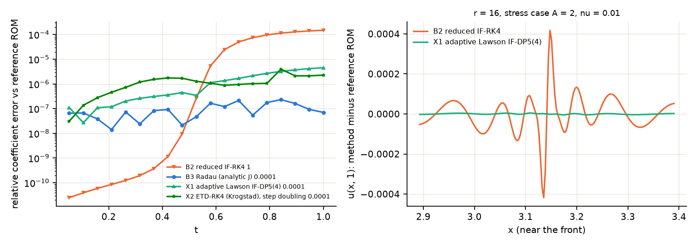 9. Trajectory and front errors (stress case). | 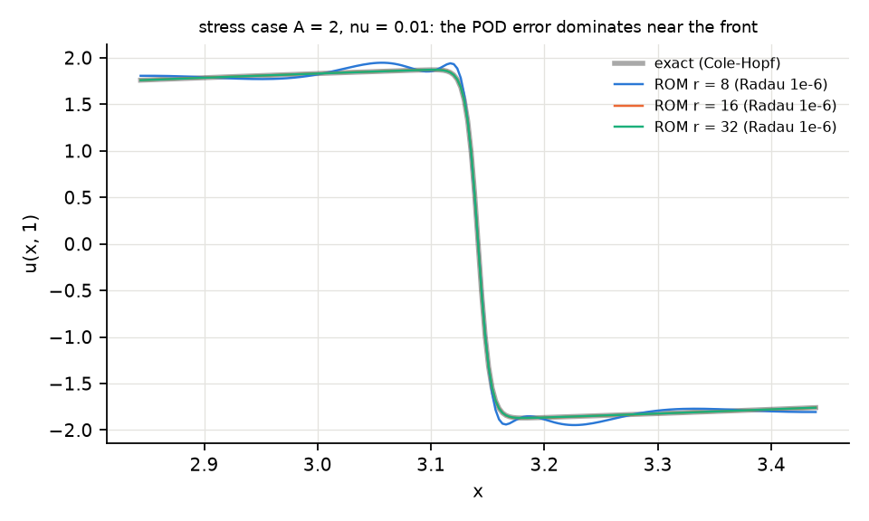 10. Steep-front profiles by rank. |
| 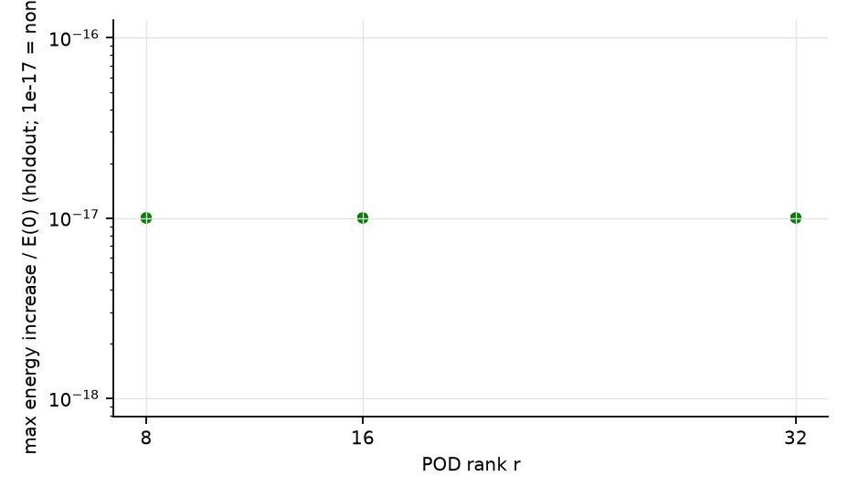 11. Energy increase (holdout). | 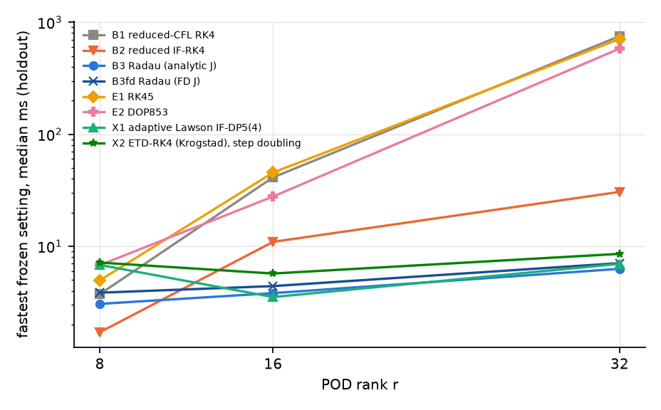 12. Runtime vs rank (holdout). |
| 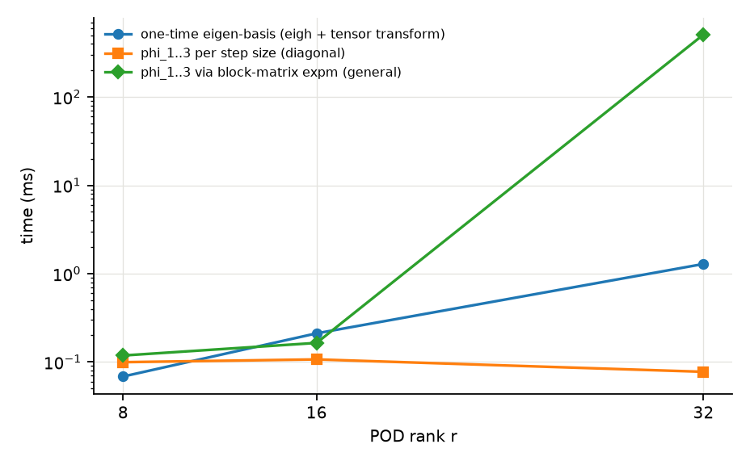 13. Matrix-function costs. | 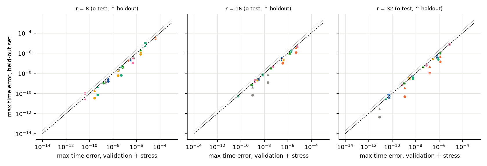 14. Validation vs held-out errors. |

Figure 7 counts rejected steps for the scipy methods only on the representative stress case (where steps were
recorded); for the new methods on every case.

## 16. Reproduction

```bash
uv venv --python 3.11 .venv && uv pip sync --python .venv/bin/python requirements-lock.txt
# data/*.npz as in README; the N = 2048 training ensemble is regenerated if absent
for s in if_failure stiffness explore; do .venv/bin/python scripts/adaptive_integrators_study.py $s --tag run1; done
.venv/bin/python scripts/adaptive_integrators_study.py select           # writes selection_frozen.json
.venv/bin/python scripts/adaptive_integrators_study.py final --tag run1   # idle machine
.venv/bin/python scripts/adaptive_integrators_study.py final --tag run2
.venv/bin/python scripts/adaptive_integrators_study.py compare --tag final
.venv/bin/python scripts/plot_adaptive_integrators_study.py
.venv/bin/python -m pytest -q tests
```

Run time about 3.5 hours (each final run about 1.3 hours, dominated by the stability-limited explicit
configurations at r = 32).

## 17. Files and tests

| file | content |
|---|---|
| `src/exponential_integrators.py` | phi-functions, block-matrix phi, eigen-coordinates, Lawson IF-DP5(4), Krogstad ETD-RK4 |
| `src/adaptive_integrators.py` | error-controlled driver, scipy RK45 / DOP853 / Radau wrappers with statistics |
| `src/reduced_stiffness.py` | diffusion spectrum, Jacobian abscissae, Henrici departure, transient amplification |
| `scripts/adaptive_integrators_study.py` | stages if_failure, stiffness, explore, select, final, compare |
| `scripts/plot_adaptive_integrators_study.py` | Figures 1 to 14 |
| `tests/test_adaptive_integrators.py` | 53 tests (+3 skipped by design): phi-functions against 60-digit references, block-matrix phi on a Jordan block, eigen-coordinates, linear exactness, Riccati orders and stiff Riccati, error-estimate behaviour, step accounting, output alignment, agreement of all methods with a high-accuracy reduced solution, zero mean and energy, reproducibility, Radau statistics, stiffness diagnostics |

No earlier source file, result or report was modified.

Full suite: **282 passed, 4 skipped** (229 existing + 53 new) in both pinned environments
(`requirements-lock.txt`, NumPy 1.26.4; `requirements-lock-numpy2.txt`, NumPy 2.4.6); offline, CPU only.
