# Spatial Convergence, Reference Verification and Time-Integration Efficiency for Viscous Burgers ROMs

## 1. Abstract

The earlier tensorial POD / spectral DEIM study measured every reduced-order model (ROM) against the
pseudo-spectral full-order model (FOM) at N = 128 points and noted that this reference differs from an
N = 1024 solution by up to 3.9% on steep cases. This study asks how far that reference, and the ROMs
built on it, are from the solution of the partial differential equation (PDE), and whether the reduced
time stepping can be made cheaper.

An exact reference is computed with the Cole-Hopf transformation (Hopf integral form, evaluated stably
with a log-sum-exp shift). It agrees with an independent FOM run at N = 8192 to 4.3e-12 on the steepest
case, and its estimated uncertainty is at most 2.2e-11 over all 48 checked cases. Against it:

* The FOM converges spectrally in space and at fourth order in time. **N = 128 is not sufficient**: on
  the 40 test cases its error has mean 0.42% and maximum 4.4% (five cases above 1%), the steepest
  fronts are resolved by 0.2 to 0.35 grid points, and the solution violates the maximum principle by 8%
  (17.6% at the steepest corner of the parameter box, A = 2, nu = 0.01). N = 1024 reaches a maximum of
  8.5e-6 on the test set but 3.0e-4 at that corner; N = 2048 reaches 2.6e-9 and 1.2e-6.
* **Tensorial POD remains accurate against the exact solution once the FOM is resolved.** At N = 128 every
  rank r >= 12 is limited by the FOM's spatial error (4.2e-3 mean against the exact solution, while the
  r = 8 ROM is within 4.7e-4 of its FOM, the figure reported earlier). At N = 2048 the rank governs the
  error: 6.0e-4 (r = 8), 7.7e-7 (r = 16), 4.4e-11 (r = 32).
* **Spatial refinement changes one method ranking**: the hybrid DEIM/local-FD model, ten times worse than
  tensorial POD at N = 128, ties it at N = 2048; tensorial POD and spectral Q-DEIM remain equal.
* **Reduced-order time stepping.** The current step rule carries the full-grid spacing into the reduced
  system. A reduced CFL bound, max|u0| sqrt(rho(L)), derived from the basis and verified to bound the
  nonlinear Jacobian (measured ratio at most 0.81), passes the pre-registered accuracy and stability
  test on every validation and test case and cuts the right-hand-side (RHS) evaluations by up to 5.1x.
  An implicit Radau integrator is the fastest robust option when the reduced diffusion is stiff (r = 16,
  N >= 512). A reduced integrating-factor RK4 is the cheapest but fails the pre-registered accuracy test
  at r = 16.

All results are in `report/spatial_convergence/` (JSON and figures); the pre-registered plan is
`report/spatial_convergence/PLAN.md`. Numbers come from NumPy 1.26.4 on an Apple M3 Pro unless stated.

## 2. Research motivation

The verified results of the earlier study (POD-Galerkin, tensorial POD, spectral DEIM) were all errors
relative to the N = 128 FOM. That is the right measure of reduced-model fidelity to a discrete model,
but it says nothing about fidelity to the PDE. Five questions follow (RQ1 to RQ5 in the task): does the
FOM converge in space, is N = 1024 a sufficient reference, how accurate is tensorial POD against a
resolved solution, how does the total error decompose, and can reduced-order-specific time stepping cut
cost without losing accuracy or stability. The earlier results and conclusions are not modified.

## 3. Mathematical formulation

u_t + u u_x = nu u_xx on x in [0, 2 pi) (periodic), t in [0, 1], u(x, 0) = A sin x, A in [0.5, 2.0],
nu in [0.01, 0.1]; 20 snapshots at t_j = j / 19. Parameter extrapolation cases (A, nu) = (2.5, 0.05),
(1.0, 0.15), (0.2, 0.05); unseen family u0 = A1 sin x + A2 sin 2x (20 cases).

**Energy identity.** d/dt (1/2) int u^2 dx = -nu int u_x^2 dx: the convective term is energy neutral.

**Cole-Hopf.** With u = -2 nu phi_x / phi the equation becomes phi_t = nu phi_xx, and

    u(x, t) = int ((x - y)/t) w dy / int w dy,   w = exp(-G / (2 nu)),   G = F0(y) + (x - y)^2 / (2t),

with F0(y) = int_0^y u0, over y in R; for zero-mean periodic u0 this is the periodic solution. For the
sine family F0 = A (1 - cos y); for the two-mode family F0 = A1 (1 - cos y) + (A2/2)(1 - cos 2y).

**Why not the Fourier series of phi.** phi(x, 0) = exp(-F0/(2 nu)) spans e^0 to e^{-A/nu} (about e^{-200}
at A = 2, nu = 0.01), with its minimum exactly at the front x = pi. A Fourier sum of phi computes that
minimum as a difference of O(1) terms, so the ratio phi_x/phi loses all accuracy where it matters. The
integral form avoids this: the largest weight is shifted to 1 (log-sum-exp) and every term is positive.

**Quadrature.** Trapezoidal rule (spectrally accurate for these smooth, rapidly decaying integrands) on
y = x + s, |s| <= W = sqrt(t (2R + 4 nu TAIL)), R = max F0 - min F0, TAIL = 60, which bounds every
neglected weight by e^{-60}; step h = (1/40) min(sqrt(2 nu t), sqrt(2 nu / max|u0'|)), a fraction of the
two length scales of the integrand. Both are verified by refinement (Section 7).

## 4. Numerical methods

**FOM as implemented** (`src/solver.py`, read and verified numerically, `PLAN.md` Section 2):
* normalised wavenumbers k = 2 pi fftfreq(N, 2 pi / N) (integers; the Nyquist mode is k = -N/2);
* N(u) = Re ifft(-0.5 i k mask fft(u^2)) with the 2/3 mask |k| < N/3 applied to the product only; since
  the IC is band-limited and nothing forces |k| >= N/3, the resolved bandwidth is |k| <= ceil(N/3) - 1
  (42 at N = 128, 682 at N = 2048);
* Lawson integrating-factor RK4 in Fourier space with exact diffusion; dt = 0.25 dx / max|u0|, at least
  80 steps, rounded up to a multiple of 19 when `align_snapshots=True` (snapshots at exactly j/19);
* snapshots are cast to float32 (a relative floor of about 6e-8).

**New, without changing the baseline** (`src/convergence.py`):
* `solve_burgers_f64`: the same operations in float64 with an explicit step count (its float32 cast is
  bit-identical to `solve_burgers`, tested);
* cross-resolution errors from normalised Fourier coefficients c_k = fft(u)/N: the coarser field is
  zero-padded, a coarse Nyquist coefficient split equally between k = +N/2 and -N/2 (keeps the
  interpolant real and unchanged); ||u||_L2^2 = 2 pi sum |c_k|^2 exactly for trigonometric interpolants.
  No grid is ever indexed into another. Errors: relative L2 over the whole space-time trajectory, per
  snapshot, and at t = 1;
* the Cole-Hopf solution above.

**Reduced models.** Tensorial POD (`src/tensorial_pod.py`, unchanged) with POD bases rebuilt at each N
from the 200 historical training parameters (float64 FOM, aligned, cached in gitignored
`data/convergence_train_N*.npz`); new reduced time integrators in `src/reduced_timestep.py` (Section 11).

## 5. Spatial convergence (`spatial_run1.json`, Figures 1, 5, 6)

**Representative cases** (pre-registered: corners and centre of the parameter box, the three steepest
earlier test cases, three extrapolation cases), every N with the same step count (the baseline count of
the N = 4096 grid), relative L2 space-time error against the exact solution:

| case (A, nu) | 64 | 128 | 256 | 512 | 1024 | 2048 | 4096 |
|---|---|---|---|---|---|---|---|
| 0.5, 0.1 | 3.1e-11 | 3.3e-15 | 3.3e-15 | 3.3e-15 | 3.4e-15 | 3.3e-15 | 3.4e-15 |
| 2.0, 0.1 | 5.5e-3 | 1.3e-4 | 7.1e-8 | 2.2e-13 | 2.2e-13 | 2.2e-13 | 2.2e-13 |
| 0.5, 0.01 | 8.1e-8 | 3.6e-13 | 4.7e-15 | 4.6e-15 | 4.6e-15 | 4.6e-15 | 4.6e-15 |
| **2.0, 0.01** | 1.6e-1 | **7.6e-2** | 2.7e-2 | 5.3e-3 | **3.0e-4** | 1.2e-6 | 1.0e-9 |
| 1.25, 0.055 | 2.0e-3 | 3.7e-5 | 1.3e-8 | 8.9e-14 | 8.9e-14 | 8.9e-14 | 8.9e-14 |
| test 5: 1.89, 0.0158 | 1.1e-1 | **4.4e-2** | 1.1e-2 | 9.1e-4 | 8.5e-6 | 8.7e-10 | 1.6e-10 |
| test 33: 1.50, 0.0122 | 7.5e-2 | 3.2e-2 | 7.8e-3 | 6.8e-4 | 6.6e-6 | 7.9e-10 | 1.1e-10 |
| test 0: 1.92, 0.0383 | 4.7e-2 | 9.4e-3 | 4.9e-4 | 1.8e-6 | 2.5e-11 | 6.7e-12 | 6.7e-12 |
| 2.5, 0.05 (extrap.) | 5.4e-2 | 1.1e-2 | 5.2e-4 | 1.7e-6 | 2.2e-11 | 6.8e-12 | 6.8e-12 |
| 1.0, 0.15 (extrap.) | 2.8e-7 | 5.3e-13 | 5.0e-15 | 4.9e-15 | 4.9e-15 | 4.9e-15 | 4.9e-15 |
| 0.2, 0.05 (extrap.) | 7.2e-15 | 7.2e-15 | 7.2e-15 | 7.2e-15 | 7.2e-15 | 7.2e-15 | 7.2e-15 |

(N = 8192 repeats the N = 4096 column. Final-time and worst-snapshot errors are in the JSON file and are
1.5 to 2 times the space-time values for the steep cases, since the front is steepest late; for
A = 2, nu = 0.01 the final-time error is 14% at N = 128 and 4.8e-4 at N = 1024.)

Convergence is spectral (faster than any power of N) until a floor. The floors of 1e-10 to 1e-9 on the
steepest rows at N >= 4096 are **not spatial**: they are the temporal error of the common step count
(Section 6: doubling the steps lowers the steepest case from 1.0e-9 to 6.9e-11 at N = 4096). The other
floors (1e-15 to 1e-13) are float64 round-off.

**Consecutive differences** E(N, 2N) mirror the errors down to the floor but then fall to 3e-16 (for example
test 5 at N = 4096: E(N, 2N) = 3.8e-16 while the error against the exact solution is 1.6e-10). Both runs
share the same time steps, so their common temporal error cancels: consecutive differences measure
spatial self-convergence, not accuracy. This is why a verified reference was needed.

**All 40 test cases** (baseline step rule at each N, the FOM as used for ROM training):

| N | mean | median | max | > 1% | > 1e-3 | > 1e-6 |
|---|---|---|---|---|---|---|
| 64 | 1.6e-2 | 4.0e-3 | 1.1e-1 | 14 | 23 | 31 |
| 128 | 4.2e-3 | 1.2e-4 | 4.4e-2 | 5 | 13 | 24 |
| 256 | 6.1e-4 | 1.2e-7 | 1.1e-2 | 1 | 3 | 15 |
| 512 | 4.1e-5 | 4.0e-10 | 9.1e-4 | 0 | 0 | 9 |
| 1024 | 3.8e-7 | 2.7e-11 | 8.5e-6 | 0 | 0 | 2 |
| 2048 | 1.4e-10 | 1.8e-12 | 2.6e-9 | 0 | 0 | 0 |

The error is governed by viscosity and amplitude together (Figures 5 and 6): every test case above 1% at
N = 128 has nu < 0.04 and A > 1.4; the controlling quantity is the front width (Section 8).

## 6. Temporal convergence (`temporal_run2.json`, Figure 2)

At fixed N, runs with 1, 2, 4 and 8 times the baseline step count are compared with 64 times the count at
the same N, so the spatial error cancels exactly. Observed order p = log2(e_m / e_2m), computed only where
both errors exceed 1e-11 (ten times the round-off plateau of about 1e-12 observed at N >= 1024; run 1 used
1e-12 and is kept):

| case | N = 256 | N = 1024 | N = 2048 |
|---|---|---|---|
| A = 2, nu = 0.01 | 3.95, 3.98, 3.99 | 3.88, 3.93, 3.96 | 3.90, 3.95 |
| test 5 | 3.92, 3.96, 3.98 | 3.91, 3.97 | 3.93, 3.94 |
| test 33 | 3.91, 3.96, 3.98 | 3.92, 3.97 | 3.93 |
| A = 2, nu = 0.1 | 3.93, 3.97 | (below floor) | (below floor) |
| A = 1.25, nu = 0.055 | 3.95, 3.98 | (below floor) | (below floor) |
| A = 0.5 (both nu) | (below floor) | (below floor) | (below floor) |

The Lawson integrating-factor RK4 shows its formal fourth order wherever the error is measurable. The
order does not deteriorate with spatial under-resolution at N = 256 (where the steep cases have
0.3 to 1.4 points per front width): the temporal error is measured against the same discrete system.

**Required temporal resolution.** At the baseline step rule the temporal error of the FOM is below 6.6e-7
(N = 256, steepest case) and 1.4e-8 (N = 2048, steepest case): far below the spatial error for N <= 1024,
but the dominant FOM error at N = 2048 on the steepest cases (Section 10).

## 7. Reference verification and uncertainty (`reference_run1.json`, Figure 4)

For the 11 representative and the 40 test cases (48 distinct cases: test cases 0, 5 and 33 are in both sets):

* quadrature refinement (step halved): at most 4.7e-16;
* sampling: the energy of the exact solution beyond |k| = N_ref/4 on the N_ref = 8192 grid is at most
  1.5e-30 (the reference is sampled far above its bandwidth);
* independent check against the FOM:

| case | N = 4096, baseline steps | 4096, 2x | 8192, baseline | 8192, 2x |
|---|---|---|---|---|
| A = 2, nu = 0.01 | 1.0e-9 | 6.9e-11 | 6.7e-11 | **4.3e-12** |
| test 5 | 1.6e-10 | 1.0e-11 | 1.0e-11 | 6.7e-13 |
| test 33 | 1.1e-10 | 7.2e-12 | 7.3e-12 | 4.6e-13 |
| test 0 | 6.7e-12 | 4.3e-13 | 4.3e-13 | 3.5e-13 |
| A = 1.25, nu = 0.055 | 8.9e-14 | 3.6e-14 | 3.6e-14 | 2.5e-13 |

The discrepancy falls by 16 with each doubling of the step count (temporal error of the FOM) and not with
N, so it is the FOM, not the reference, that limits the agreement. **Estimated reference uncertainty:**
for each case the larger of the quadrature-refinement change and the smallest FOM discrepancy; the
maximum over all 48 cases is 2.2e-11 (space-time) and 4.9e-11 (worst snapshot). This is an upper bound:
the 40 test cases were checked only against the N = 4096 FOM with its baseline step count, whose own
temporal error dominates that value. All errors quoted as "against the exact solution" carry this
uncertainty; values below about 1e-11 are not resolved by it.

## 8. Spectral and physical diagnostics (`diagnostics_run1.json`, Figures 3, 10, 14)

At the time of steepest gradient, front width 2 nu / U (U = max|u|), points per front width (ppw), energy
of the exact solution beyond the grid's resolved bandwidth, and maximum-principle overshoot
max_t max|u_N(t)| / max|u0| - 1:

| case | width | N = 128: ppw / tail / overshoot | N = 512 | N = 2048 |
|---|---|---|---|---|
| A = 2, nu = 0.01 | 0.0101 | 0.21 / 5.4e-3 / **+17.6%** | 0.82 / 7.0e-5 / +1.1% | 3.3 / 6.3e-12 / 0 |
| test 5 | 0.0170 | 0.35 / 3.0e-3 / **+8.2%** | 1.38 / 3.0e-6 / 0 | 5.5 / 4.3e-18 / 0 |
| test 33 | 0.0165 | 0.34 / 3.0e-3 / **+8.5%** | 1.34 / 3.3e-6 / 0 | 5.4 / 8.3e-18 / 0 |
| test 0 | 0.0414 | 0.84 / 2.6e-4 / 0 | 3.4 / 1.6e-11 / 0 | 13.5 / 2.8e-31 / 0 |
| A = 1.25, nu = 0.055 | 0.0932 | 1.9 / 2.0e-8 / 0 | 7.6 / 1.3e-28 / 0 | 30 / 1e-31 / 0 |
| A = 0.5, nu = 0.01 | 0.0404 | 0.82 / 2.5e-24 / 0 | 3.3 / 9e-32 / 0 | 13 / 8e-32 / 0 |

* **Unresolved structure** at N = 128: the FOM's coefficient at the cutoff is 9% (test 5) and 14%
  (A = 2, nu = 0.01) of the largest coefficient, the spectrum has no decay before the cutoff (Figure 3),
  the maximum gradient is underestimated by a factor 2 to 3 (|u_x| max ratio 0.50 and 0.33), and Gibbs
  oscillations overshoot the maximum principle by 8% to 18% (Figure 14). At N = 128 and 256 the FOM
  spectrum of test 5 rises just below the cutoff instead of decaying (Figure 3, right): energy piles up
  at the highest retained modes, the spectral signature of those oscillations. From N = 512 on, the FOM
  spectrum follows the exact one down to the cutoff.
* **Spectral decay is not proof of convergence**: A = 0.5, nu = 0.01 has 0.82 points per front width at
  N = 128 yet an error of 3.6e-13, because its "front" (width 2 nu / U with U about 0.5) is a smooth sine
  that never steepens; the energy beyond the cutoff (2.5e-24) is the reliable indicator here, the width
  heuristic is not.
* **Mass** is conserved to 2e-15 at every N. **Energy** never increases between snapshots at any N; its
  error against the exact energy is 1.1% (A = 2, nu = 0.01) and 0.34% (test 5) at N = 128, 2.5e-5 and
  8.6e-7 at N = 512 (Figure 10). The discrete convective (aliasing) energy production is at most 1.9e-14
  of the viscous dissipation at every N and case: the dealiased product is energy neutral to round-off,
  so the energy deficit at low N is not a numerical energy source but the wrong (under-resolved)
  dissipation rate.

## 9. Tensorial POD against the exact solution (`rom_run1.json`, Figures 7, 8, 9, 13)

POD bases from the 200 training trajectories at each N (float64), r in {4, 8, 12, 16, 24, 32}, current step
policy; means over the 40 test cases:

| N | FOM vs exact | r = 8: vs FOM / vs exact | r = 16 | r = 32 | projection error of exact, r = 8 / 16 / 32 |
|---|---|---|---|---|---|
| 128 | 4.2e-3 | 4.7e-4 / 4.4e-3 | 2.3e-6 / 4.2e-3 | 2.0e-7 / 4.2e-3 | 3.4e-3 / 3.2e-3 / 3.2e-3 |
| 256 | 6.1e-4 | 5.3e-4 / 1.0e-3 | 1.4e-6 / 6.1e-4 | 6.8e-8 / 6.1e-4 | 7.4e-4 / 5.2e-4 / 5.2e-4 |
| 512 | 4.1e-5 | 6.0e-4 / 6.1e-4 | 1.3e-6 / 4.2e-5 | 1.4e-8 / 4.1e-5 | 2.8e-4 / 3.9e-5 / 3.9e-5 |
| 1024 | 3.8e-7 | 6.0e-4 / 6.0e-4 | 7.6e-7 / 1.1e-6 | 1.8e-9 / 3.8e-7 | 2.6e-4 / 6.2e-7 / 3.7e-7 |
| 2048 | 1.4e-10 | 6.0e-4 / 6.0e-4 | 7.7e-7 / 7.7e-7 | 1.3e-10 / 4.4e-11 | 2.6e-4 / 2.6e-7 / 4.1e-11 |

(r = 4: 1.4% at every N; r = 12 and 24 in the JSON file. No ROM was unstable at any N or rank.)

* **Against its own FOM**, the ROM error depends on r and hardly on N (r = 8: 4.7e-4 to 6.0e-4): the
  r = 8 figure of the earlier study (4.7e-4 at N = 128) is a property of the rank.
* **Against the exact solution**, the ROM can be no better than the FOM it was trained on, up to the
  time-step effect below. At N = 128 every r >= 12 sits at the FOM's 4.2e-3; at N = 2048 the rank decides.
* **Accuracy retained.** Once the FOM is resolved, tensorial POD keeps its accuracy against the exact
  solution: r = 16 gives 7.7e-7 (max 2.6e-6) at N = 2048, r = 32 gives 4.4e-11 (max 8.6e-10).
* **Projection vs trajectory** (Figure 9): the trajectory error is 1.1 to 3.2 times the POD projection error
  of the exact solution (r = 8: 6.0e-4 vs 2.6e-4; r = 16: 7.7e-7 vs 2.6e-7 at N = 2048); the reduced
  dynamics add a small multiple of the best-approximation error and do not amplify it further.
* **ROM closer to the exact solution than its FOM** (N = 2048, r = 32: 4.4e-11 vs 1.4e-10): on the steepest
  cases the ROM's step rule takes 1.8 to 3.8 times more steps than the FOM (the diffusion bound with a
  large rho(L)), and the FOM's error there is temporal (Section 6). It is a time-step effect, not a sign
  that the ROM is more accurate than the discrete model.

**Generalization** (means; Section 13 of the earlier report used the N = 128 FOM as reference):

| | N = 128: FOM / r = 8 / r = 32 vs exact | N = 2048: FOM / r = 8 / r = 32 vs exact |
|---|---|---|
| extrapolation (3 cases) | 3.5e-3 / 3.9e-3 / 3.5e-3 | 3.6e-11 / 1.1e-3 / 5.7e-12 |
| two-mode family (20) | 1.7e-3 / 1.8e-2 / 2.0e-3 | 6.3e-11 / 1.8e-2 / 5.6e-4 |

The earlier conclusion holds against the exact solution: the POD-Galerkin ROM extrapolates in A and nu
almost as well as it interpolates (its extrapolation error is rank-limited, r = 8: 1.1e-3), while the
unseen initial-condition family is limited by the basis (r = 8: 1.8% at every N; r = 32: 5.6e-4), not by
the resolution.

**Offline cost** (N = 2048): 200 training FOM runs 50 s, SVD 4.4 s, tensor construction 5 ms (r = 8) to
63 ms (r = 32); at N = 128: 0.06 s SVD, under 6 ms tensors.

## 10. Error decomposition

With the verified reference standing in for u_PDE (uncertainty at most 2.2e-11):

    u_ROM - u_PDE = (u_ROM - u_FOM) + (u_FOM - u_PDE),

and further u_ROM - u_FOM = (projection error of u_FOM) + (error accumulated by the reduced dynamics),
where the reduced dynamics include reduced time integration. The norms do not add exactly (the two
parts are not orthogonal), so the decomposition is read component by component (test means):

| source | N = 128 | N = 2048 | evidence |
|---|---|---|---|
| FOM spatial error | 4.2e-3 (max 4.4e-2) | below 1e-11 | Section 5 |
| FOM temporal error | below 6.6e-7 | up to 1.4e-8 (steepest) | Section 6 |
| POD truncation (projection of the exact solution) | 3.4e-3 (r = 8), 3.2e-3 (r = 32) | 2.6e-4 (r = 8), 4.1e-11 (r = 32) | Section 9 |
| reduced dynamics (ROM vs FOM) | 4.7e-4 (r = 8), 2.0e-7 (r = 32) | 6.0e-4 (r = 8), 1.3e-10 (r = 32) | Section 9 |
| reduced time integration (current policy) | below 4e-8 | below 4e-12 | Section 11 |
| parameter extrapolation | ROM vs exact 3.9e-3 vs 4.4e-3 in range (r = 8) | 1.1e-3 vs 6.0e-4 | Section 9 |
| floating point | about 1e-15 per operation, plateau 1e-12 | | Sections 5, 6 |

At N = 128 the FOM's spatial error dominates for every ROM with r >= 8 (the r = 8 ROM's own error,
4.7e-4, is a ninth of it); at N = 2048 the POD rank dominates and the FOM is effectively exact. At
N = 128 the projection error of the exact solution (3.2e-3) is large even for r = 32 because the basis
lives on the N = 128 grid: it cannot represent what that grid cannot resolve.

## 11. Reduced time-integration efficiency (`timestep_run1.json`, `timestep_run2.json`, Figures 11, 12)

**Why reduced step counts grow with N.** The current policy is
dt = min(0.25 dx / max|u0|, 0.5 * 2.785 / (nu rho(L))). Its advective bound uses the full-grid dx, so the step
count grows like N even though the reduced system has r unknowns; its diffusion bound grows with rho(L),
which at r = 8 saturates (1732, 8143, 8216 at N = 128, 512, 2048) but at r = 16 keeps growing
(1764, 28885, 57671) as the basis resolves finer scales of the training data.

**Reduced CFL bound.** For v = Phi b, ||D1 v||^2 = -b^T L b <= rho(L) ||b||^2 (D2 = D1^2, D1 skew), and
Phi^T G = (1/2)(D1_mask Phi)^T, which gives ||J_nl(a)||_2 <= ||Phi a||_inf sqrt(rho(L)) for the nonlinear
Jacobian. Along the projected FOM trajectories of all validation cases the measured ratio
||J_nl|| / (||Phi a||_inf sqrt(rho(L))) is at most 0.50 / 0.81 (N = 128, r = 8 / 16), 0.33 / 0.52 (N = 512),
0.33 / 0.33 (N = 2048), so the bound holds with margin; the largest real part of the full Jacobian's
eigenvalues is negative everywhere (-0.21 to -0.42). The bound constrains the size of the eigenvalues,
not their sign; stability was therefore checked empirically, as pre-registered.

**Policies** (fixed before the runs):
* P0 current policy;
* P1 reduced CFL: dt = 0.5 min(2.83 / (max|u0| sqrt(rho(L))), 2.785 / (nu rho(L))) with RK4 (the same 0.5
  safety factor and RK4 stability limits as the existing diffusion bound);
* P2 reduced integrating-factor RK4 (Lawson; exp(nu L dt) exact via the eigendecomposition of the
  symmetric L): only the advective bound remains;
* P3 adaptive RK45 and P4 implicit Radau (scipy.integrate.solve_ivp, rtol 1e-6, atol 1e-9; Radau with the
  exact Jacobian).

**Pre-registered acceptance**: stable on every case and per-case error against the same-N FOM at most
1.05 times P0's plus 1e-6; decided on the 40 validation cases, then evaluated once on the 40 test cases.
Test means: RHS evaluations per trajectory and solver time (run 1; run 2 agrees within about 5% and has
identical acceptance):

| N, r | FOM steps | P0 | P1 reduced CFL | P2 reduced IF-RK4 | P3 RK45 | P4 Radau |
|---|---|---|---|---|---|---|
| 128, 8 | 123 | 504 / 1.39 ms | 312 / 0.86 ms | 180 / **0.62 ms** | 433 / 2.20 ms | 796 / 7.82 ms |
| 128, 16 | 123 | 505 / 1.70 | 319 / **1.08** | fails (val, test) | 387 / 2.20 | 818 / 8.54 |
| 512, 8 | 421 | 1910 / 5.12 | 1284 / 3.45 | 359 / **1.19** | 1098 / 5.06 | 931 / 8.91 |
| 512, 16 | 421 | 4492 / 14.8 | 4435 / 14.6 | passes val, fails test | 3185 / 16.3 | 930 / **9.72** |
| 2048, 8 | 1655 | 6620 / 22.5 | 1298 / 4.34 | 359 / **1.48** | 1126 / 6.72 | 961 / 12.3 |
| 2048, 16 | 1655 | 10045 / 34.9 | 8810 / 30.7 | passes val, fails test | 6461 / 34.4 | 1031 / **11.4** |

* **P1** is accepted on every validation and test case at every (N, r); at N = 2048, r = 8 it needs 5.1
  times fewer RHS evaluations than P0 at identical accuracy (time error 3e-7, ROM error unchanged at
  6.0e-4). Where the diffusion bound dominates (r = 16, N >= 512) it gains little (1.0 to 1.14x).
* **P0 is conservative but not by much**: doubling P0's step keeps every case stable, quadrupling it
  makes some cases unstable (work-precision sweep, N = 2048, r = 8); P1 removes that factor of about 4
  and itself becomes unstable at four times its step.
* **P2** is the cheapest (180 to 893 evaluations), but its time error (up to 4e-5) exceeds the pre-registered
  margin at r = 16, where the ROM's own error is about 1e-6. It passed validation at N = 512 and 2048 and
  then failed on the two steepest test cases (5 and 33, nu = 0.012 to 0.016), which are steeper than any
  validation case: validation acceptance did not transfer, and P2 is not recommended without an error
  control. It is never unstable.
* **P3** (RK45) needs about 8600 evaluations at N = 2048, r = 16 at every tolerance from 1e-3 to 1e-8: its
  steps are set by stability, not accuracy, the signature of a stiff system. **P4** (Radau) needs about
  1000 evaluations (plus LU factorizations of an r x r matrix) independently of N and is the fastest
  robust policy where rho(L) is large; its per-step overhead makes it the slowest at N = 128.

**Matched accuracy** (Figure 12, N = 2048, r = 8, validation): to reach a time error of 1e-8 or better,
P0 needs about 3200 evaluations (twice its step; four times is unstable), P1 about 1700 (5e-9), RK45 about
1300 (rtol 1e-6, 8e-10), while P2 stays above 4e-7 up to 660 evaluations. RK45 thus needs the fewest
evaluations at matched accuracy here, but each costs several times more in wall-clock time than a
fixed-step RK4 evaluation (scipy's per-step Python overhead), so P1 is faster in practice (4.3 against
6.7 ms).

### 11.1 Runtime scaling (`benchmark_run2.json`; `benchmark_run1.json` kept, disturbed by a system indexing burst)

Ten test cases chosen a priori by A/nu rank (every fourth), interleaved timing, 7 repetitions after a
warm-up, medians averaged over the cases; end to end = projection of u0, reduced integration and
reconstruction of all 20 snapshots (reconstruction itself costs 3 to 36 us). Accuracy is the mean error
against the exact solution on the same 10 cases (lower than the 40-case means because the subset is
spread over the A/nu range). Run 2; run 1 agrees within 20% on every entry.

| N | method | end-to-end time | speed-up vs FOM | error vs exact |
|---|---|---|---|---|
| 128 | FOM (baseline solver) | 3.99 ms | 1.0x | 2.0e-03 |
| 128 | tensorial r = 8, P0 / P1 | 1.43 / 0.95 ms | 2.8x / 4.2x | 2.3e-03 |
| 128 | tensorial r = 16, P0 / P1 | 2.48 / 1.73 ms | 1.6x / 2.3x | 2.0e-03 |
| 128 | tensorial r = 32, P0 / P1 | 7.19 / 4.67 ms | 0.6x / 0.9x | 2.0e-03 |
| 512 | FOM (baseline solver) | 29.69 ms | 1.0x | 1.4e-06 |
| 512 | tensorial r = 8, P0 / P1 | 7.75 / 5.73 ms | 3.8x / 5.2x | 5.4e-04 |
| 512 | tensorial r = 16, P0 / P1 | 25.21 / 24.62 ms | 1.2x / 1.2x | 2.3e-06 |
| 512 | tensorial r = 32, P0 / P1 | 60.04 / 64.71 ms | 0.5x / 0.5x | 1.4e-06 |
| 2048 | FOM (baseline solver) | 316.15 ms | 1.0x | 2.4e-11 |
| 2048 | tensorial r = 8, P0 / P1 | 19.28 / 4.89 ms | 16.4x / 64.6x | 5.4e-04 |
| 2048 | tensorial r = 16, P0 / P1 | 53.61 / 49.42 ms | 5.9x / 6.4x | 6.3e-07 |
| 2048 | tensorial r = 32, P0 / P1 | 931.80 / 952.66 ms | 0.3x / 0.3x | 2.4e-12 |

* The FOM cost grows like N^2 log N (more points and proportionally more steps): 4.0, 29.7, 316 ms.
* Tensorial POD at r = 8 with the reduced CFL step (P1) costs 0.95, 5.7 and 4.9 ms: its cost saturates in
  N (rho(L) saturates), giving 4.2x, 5.2x and 65x over the FOM at the same N (61x in run 1); the current
  policy P0 grows with N through its dx-based bound (1.4, 7.8, 19.3 ms). These are cost ratios at equal
  N, not at equal accuracy: at N = 2048 the FOM's error is 2.4e-11 and the r = 8 ROM's 5.4e-4.
* At r = 16 and r = 32 the diffusion bound (rho(L) up to 5.8e4 at r = 16) dominates every explicit policy:
  r = 32 at N = 2048 takes about 0.95 s, three times the FOM. The implicit Radau policy of Section 11
  (11.4 ms at N = 2048, r = 16 on the 40 test cases) removes this; it was not part of this benchmark.
* Offline: SVD 0.05 s / 0.38 s / 4.6 s (N = 128 / 512 / 2048) plus the training FOM runs (Section 9).

**Accuracy-runtime trade-off** (against the exact solution).

*Controlled (same 10 cases, same interleaved run):* the N = 128 FOM costs 4.0 ms for 2.0e-3, a tensorial POD
model built at N = 2048 with r = 8 and the P1 step costs 4.9 ms for 5.4e-4: about four times more accurate
for 23% more time. Near 1e-6, the N = 512 FOM (29.7 ms, 1.4e-6) is *faster* than r = 16 tensorial POD at
N = 2048 with explicit steps (49 ms, 6.3e-7), which is somewhat more accurate.

*Indicative only (not a head-to-head benchmark):* with the implicit Radau policy the same r = 16 model took
11.4 ms per trajectory in Section 11 (solver only, all 40 test cases, a different run and case set), and
its time-integration error there (2e-9) implies the same 6.3e-7 accuracy. That suggests a factor of about
2.5 over the N = 512 FOM at slightly better accuracy, but Radau was not timed in this benchmark, so the
factor is not established.

## 12. Discussion

**Was the N = 128 reference adequate?** For the smoother part of the parameter box, yes (16 of 40 test cases are
within 1e-6 of the exact solution at N = 128, 27 within 1e-3). For high amplitude and low viscosity, no: the front is
narrower than the grid spacing, the spectrum is cut off without decay, Gibbs oscillations violate the
maximum principle, and the error reaches 4% to 8% (test cases) and 14% at t = 1 (corner). The previous study's
reduced-model errors (about 5e-4) measured fidelity to that discrete model, which itself was up to 100
times further from the PDE on those cases. The previous conclusions about the reduced models are not
affected (they compared reduced models with the same discrete model), but any statement about accuracy
with respect to Burgers' equation must use N >= 1024 (1e-5) or N = 2048 (1e-6 everywhere in the box).

**Does refinement change rankings?** Tensorial POD and spectral Q-DEIM stay equal. The hybrid DEIM/local-FD
model's handicap shrinks with dx: at r = 8, m = 16 it is 4.4e-2 against 4.4e-3 at N = 128, 1.6e-3 against
6.1e-4 at N = 512 and 6.2e-4 against 6.0e-4 at N = 2048 (`ranking_run1.json`). Its local finite differences
become accurate once the front spans several points, which supports the earlier attribution of its
failures to local-FD sampling of an under-resolved field.

**Time stepping.** A reduced-order model should be stepped at the scales its basis represents. The
reduced CFL bound does exactly that and is safe in all tested cases; it matters most where the basis is
smooth (low r) and the full grid is fine. When the basis itself resolves fine scales (larger r), the
reduced diffusion is genuinely stiff and an implicit integrator pays off.

## 13. Limitations

* One PDE, one parameter box, two initial-condition families; the exact solution exists only because
  Burgers' equation is linearizable.
* The reference uncertainty bound (2.2e-11) is set by the FOM check, not by the Cole-Hopf evaluation
  itself; errors below about 1e-11 are not resolved.
* POD bases were built from aligned float64 trajectories at each N; the stored historical basis (float32,
  unaligned snapshots) was not reused, so numbers at N = 128 differ slightly from the earlier study's.
* The time-step policies were compared at r = 8 and 16 and N = 128, 512, 2048; rho(L) grows with r, so at
  r = 32 every explicit policy is slower than the FOM at N >= 512 (benchmark). Radau was not benchmarked
  at r = 32.
* The validation split did not contain the steepest test cases; this is why P2 passed validation and
  failed on test at two resolutions.
* Timing: one Apple M3 Pro shared with other work and file indexing (one benchmark run was discarded for
  that reason and kept on record); Python/NumPy call overhead dominates at small r.
* Not re-run: MLP and FNO; the NumPy 2 environment for this study's numbers (the test suite passes there).

## 14. Conclusions

1. **Is N = 128 sufficiently resolved for all tested cases?** No. It is accurate to 1e-6 for 16 of 40
   test cases (1e-3 for 27) but reaches 4.4% (test) and 7.6% (A = 2, nu = 0.01), with maximum-principle overshoot up to
   17.6% and the front resolved by 0.2 to 0.35 points. *Established.*
2. **Is N = 1024 sufficiently resolved?** For the test set to 8.5e-6 (max); not uniformly over the box:
   3.0e-4 at A = 2, nu = 0.01. *Established.*
3. **Resolution for the steepest cases.** About 3 points per front width (N = 2048 for A = 2, nu = 0.01)
   gives 1e-6; about 5.5 points (N = 2048 for the steepest test cases) gives 1e-9. N = 4096 brings every
   tested case to the temporal or round-off floor. *Established.*
4. **Temporal resolution.** The baseline step rule (Courant number 0.25 on the full grid) keeps the
   temporal error below 7e-7 at N = 256 and 1.4e-8 at N = 2048, with fourth-order convergence; two to
   four times more steps are needed only to push the FOM below 1e-10 at N >= 2048. *Established.*
5. **Does tensorial POD retain its accuracy against a verified reference?** Yes, once the FOM is resolved:
   7.7e-7 (r = 16) and 4.4e-11 (r = 32) at N = 2048. At N = 128 its accuracy against the PDE is that of the
   N = 128 FOM (4.2e-3). *Established.*
6. **Effect of the rank.** At resolved N the error falls by about three orders of magnitude per 8 modes
   (6.0e-4, 2.3e-5, 7.7e-7, 9.2e-10, 4.4e-11 for r = 8, 12, 16, 24, 32), tracking the POD projection error
   within a factor 1.1 to 3.2. *Established.*
7. **Does refinement change the ranking?** Yes for the hybrid DEIM/local-FD model (ten times worse at
   N = 128, equal at N = 2048); no for tensorial POD versus spectral Q-DEIM. *Established for r = 8, m = 16.*
8. **Can reduced-specific time stepping improve runtime?** Yes: the reduced CFL policy (P1) passed the
   pre-registered test everywhere and cut RHS evaluations up to 5.1x; Radau is fastest when the reduced
   diffusion is stiff. *Established for the tested (N, r).*
9. **Best accuracy-runtime trade-off.** At low cost, a tensorial POD model trained on a resolved grid
   (N = 2048, r = 8, reduced CFL step) is about four times more accurate than the N = 128 FOM at similar
   cost (4.9 vs 4.0 ms; 5.4e-4 vs 2.0e-3 against the exact solution). *Established on 10 test cases on this
   machine.* Near 1e-6, explicit r = 16 tensorial POD is slower than the N = 512 FOM (49 vs 30 ms) at
   slightly better accuracy; with Radau it would plausibly be about 2.5 times faster (11.4 ms in a separate
   run on all 40 test cases). *Hypothesis: not measured head to head.*
10. **Remaining limitations**: Section 13. Hypotheses not tested here: that a step rule based on the
    Jacobian's real parts (or an error-controlled IF-RK4) would combine P2's cost with P1's robustness;
    that the conclusions carry over to non-linearizable or multi-dimensional problems.

## 15. Reproduction

```bash
uv venv --python 3.11 .venv && uv pip sync --python .venv/bin/python requirements-lock.txt
# data/*.npz from scripts/generate_dataset.py and scripts/generate_ood_dataset.py
for s in spatial temporal reference diagnostics rom timestep; do
  .venv/bin/python scripts/spatial_convergence_study.py $s --tag run1
done
.venv/bin/python scripts/spatial_convergence_study.py temporal --tag run2    # order floor 1e-11
.venv/bin/python scripts/spatial_convergence_study.py timestep --tag run2    # timing repeat
.venv/bin/python scripts/spatial_convergence_study.py ranking --tag run1
.venv/bin/python scripts/spatial_convergence_study.py benchmark --tag run2   # on an idle machine
.venv/bin/python scripts/plot_spatial_convergence_study.py
.venv/bin/python -m pytest -q tests
```

Total run time about 1.5 hours on the machine above, dominated by `timestep`, `reference` and `rom`;
the training ensembles are cached in `data/convergence_train_N*.npz` (about 130 MB, regenerated if absent).
All accuracy results are deterministic; timings vary by a few percent.

## 16. Figures (`report/spatial_convergence/figures/`)

| | |
|---|---|
| 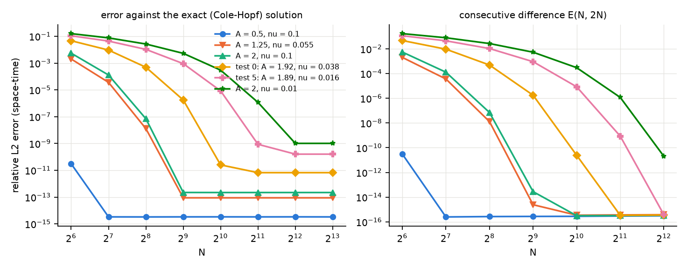 1. Spatial convergence and consecutive differences. | 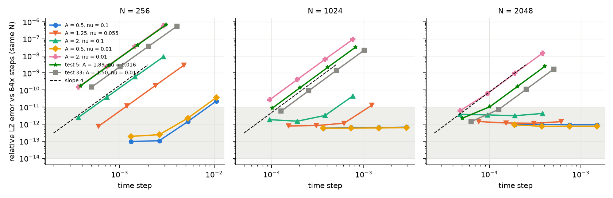 2. Temporal convergence at fixed N (shaded: below the order floor). |
| 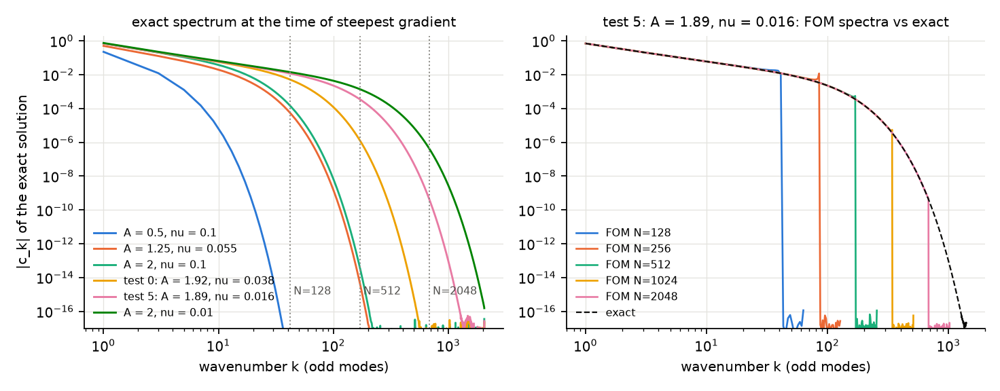 3. Exact spectra and FOM spectra (test 5). | 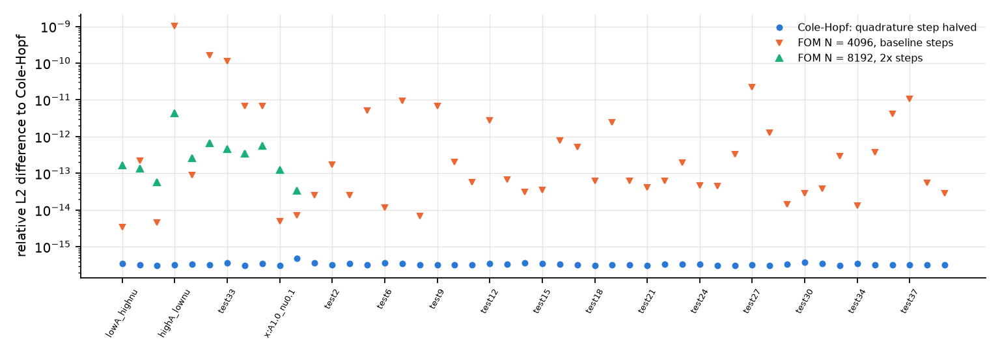 4. Reference verification, all 48 distinct cases. |
| 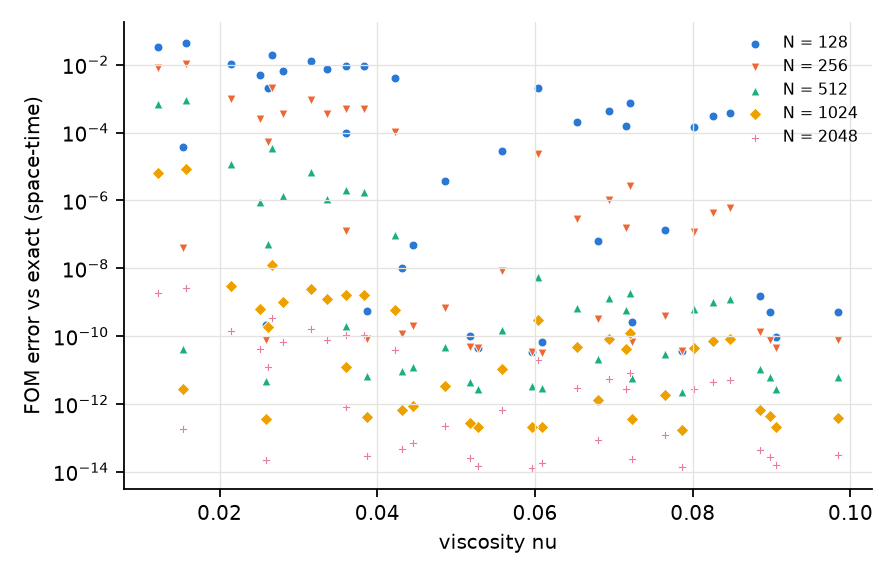 5. FOM error vs viscosity (40 test cases). | 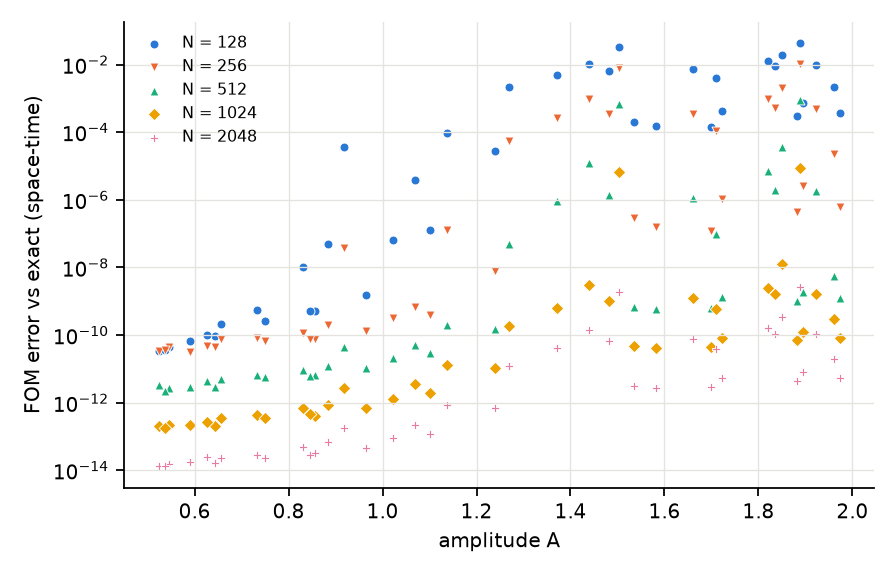 6. FOM error vs amplitude. |
| 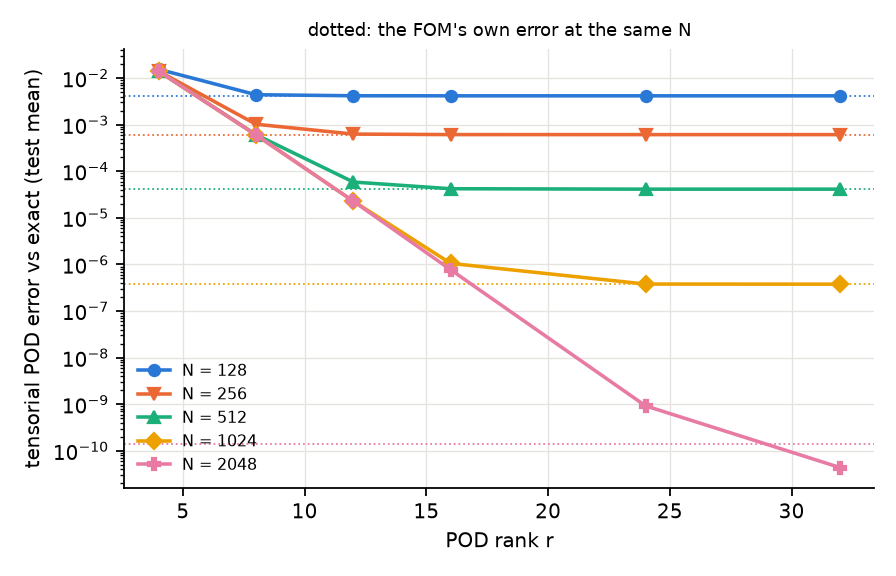 7. Tensorial POD error vs rank. | 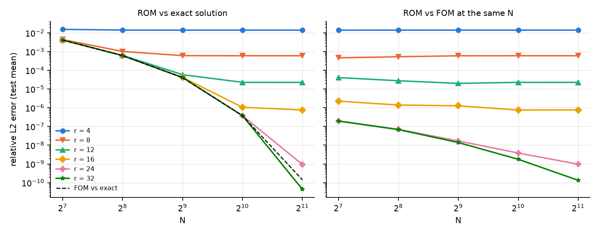 8. ROM error vs resolution. |
| 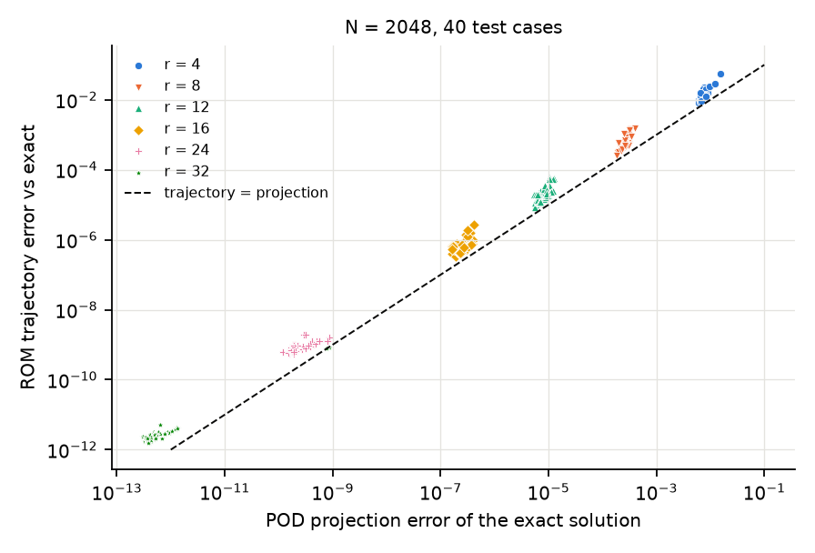 9. Projection vs trajectory error (N = 2048). | 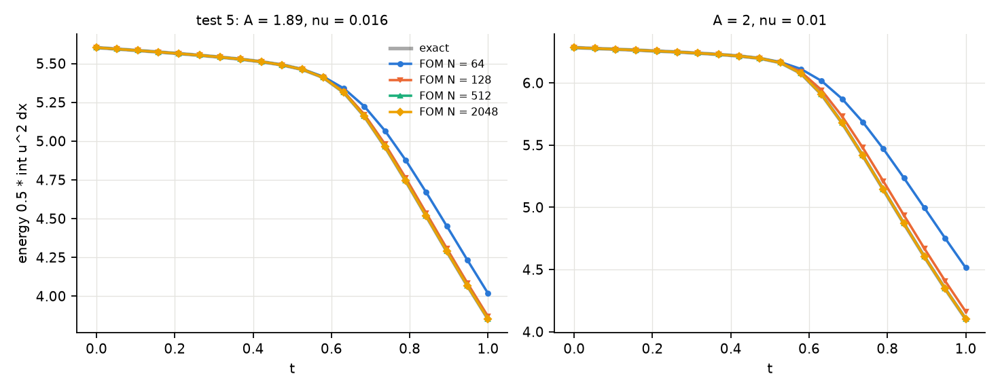 10. Energy evolution. |
| 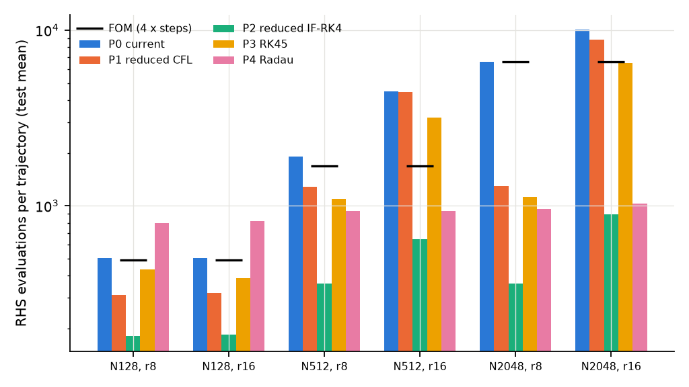 11. Reduced RHS evaluations by policy. | 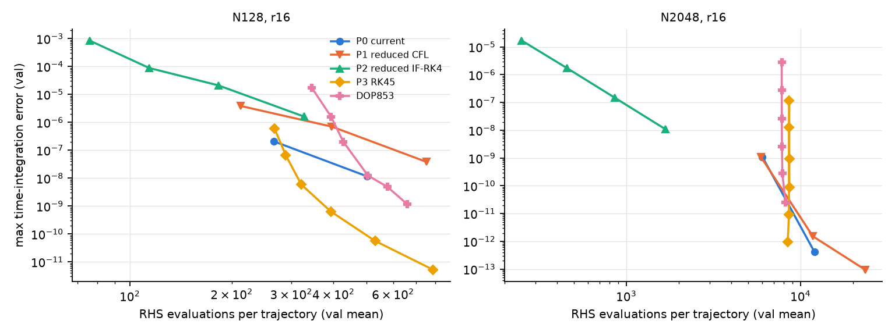 12. Time error vs cost (validation). |
| 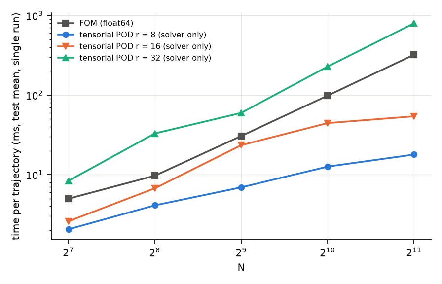 13. Runtime vs N (single runs, Section 9). | 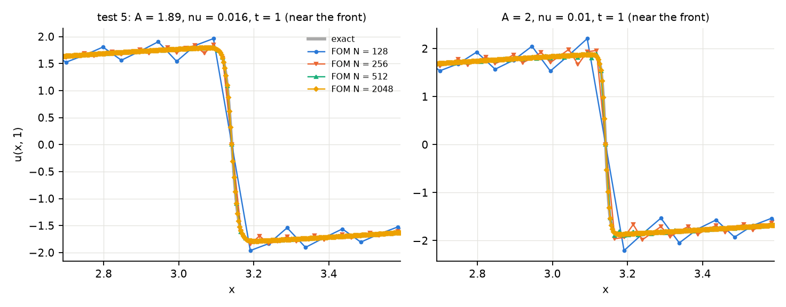 14. Steep-front profiles at t = 1. |

## 17. Files

| file | content |
|---|---|
| `src/convergence.py` | float64 FOM, Fourier padding/restriction and L2 errors across grids, Cole-Hopf solution |
| `src/reduced_timestep.py` | reduced CFL bound, reduced IF-RK4, scipy integrators with step accounting |
| `scripts/spatial_convergence_study.py` | stages spatial, temporal, reference, diagnostics, rom, timestep, benchmark, ranking |
| `scripts/plot_spatial_convergence_study.py` | Figures 1 to 14 |
| `tests/test_convergence.py` (27), `tests/test_reduced_timestep.py` (9), `tests/test_spatial_convergence_study.py` (13) | Section 18 |
| `report/spatial_convergence/PLAN.md` | baseline and pre-registered plan (written before the experiments) |

No existing source, data, result or report file was modified.

## 18. Tests

New tests cover the float64 solver's bit-identity with `src/solver.py` and `src/general_ic_solver.py`,
fourth-order temporal convergence on a smooth case, Fourier padding, restriction, the Nyquist convention,
Parseval norms and resolution-independent errors, the Cole-Hopf solution (initial value, periodicity,
odd symmetry, maximum principle, mass and energy, quadrature insensitivity, agreement with the FOM,
spectral convergence of the FOM towards it), conservation and the maximum-principle violation of the
under-resolved FOM, grid consistency, POD orthogonality at N = 512, the reduced Jacobian bound, the
reduced IF-RK4 (exact linear part, fourth order, stability beyond the explicit diffusion limit), the
scipy integrators and step accounting, the policy dispatcher and the error bookkeeping. Full suite: **228 passed, 1 skipped** (179 existing +
49 new) in both pinned environments (`requirements-lock.txt`, NumPy 1.26.4; `requirements-lock-numpy2.txt`,
NumPy 2.4.6); offline, CPU only, deterministic, no data files needed.
