# Tensorial POD-Galerkin and Spectral-Consistent DEIM for the Viscous Burgers Equation

This study asks whether a reduced-order model (ROM) of the pseudo-spectral Burgers solver can keep the
accuracy and robustness of the original POD-Galerkin ROM while avoiding its online full-grid FFTs. Two
competing approaches are derived, implemented, verified and benchmarked against the existing methods:

* **A. Tensorial POD-Galerkin**: the quadratic nonlinearity of the existing discrete model is precomputed
  as a third-order tensor.
* **B. Spectral-consistent DEIM**: DEIM (greedy, Q-DEIM and oversampled/gappy variants) applied to the
  exact discrete spectral operator, sampled through a precomputed tensor rather than local finite
  differences.

A structure-preserving (energy-conserving) correction is also investigated. Every number below is read
from `report/tensorial_deim/*.json`; the scripts that produce them are listed under
[Reproduction](#13-reproduction). The existing verified results (README, `RESEARCH_EXTENSION.md`,
`report/audit/`) are not modified.

**Summary of findings** (r = 8, 40 test cases, time-aligned protocol, Apple M3 Pro, NumPy 1.26.4):

| Method | Mean error | Max error | Cases > 10% | End-to-end time | vs full-order solver |
|---|---|---|---|---|---|
| Full-order pseudo-spectral solver | (reference) | | | 3.24 ms | 1.00x |
| POD-Galerkin, original | 0.0466% | 0.098% | 0 | 7.45 ms | 0.44x |
| **Tensorial POD-Galerkin** | **0.0466%** | **0.098%** | **0** | **1.36 ms** | **2.38x** |
| Hybrid DEIM/local-FD (m = 16), existing | 4.31% | 52.9% | 6 | 3.48 ms | 0.93x |
| Spectral DEIM (m = s = 16) | 0.0467% | 0.100% | 0 | 1.95 ms | 1.67x |
| Spectral Q-DEIM (m = s = 16) | 0.0467% | 0.098% | 0 | 1.95 ms | 1.66x |
| Spectral oversampled (m = 16, s = 32) | 0.0466% | 0.098% | 0 | 2.12 ms | 1.53x |

1. Tensorial POD reproduces the original POD-Galerkin vector field to rounding (relative difference
   at most 4e-14 for r = 4 to 16) and its trajectories to 4e-16, and is 5.5x faster than the original
   ROM and 2.4x faster than the full-order solver at Nx = 128 (7.0x at Nx = 1024, on four cases).
2. Spectral-consistent DEIM removes the instability of the hybrid local-FD model: all 48 tested
   configurations are stable on all 80 validation and test cases. With the hybrid's own basis and
   points, replacing the local-FD values by the exact sampled spectral values turns positive Jacobian
   eigenvalues (up to +4.75) into negative ones and brings every high-error case down to the Galerkin
   error.
3. No DEIM variant beats tensorial POD on accuracy or speed. For a quadratic nonlinearity this is
   structural, not an implementation detail (Section 4.4).
4. The Frobenius-nearest energy-conserving correction removes spurious energy growth but degrades
   accuracy; a variance-weighted version (designed after that result) partly improves the hybrid
   model (4.31% to 2.67%) without fixing it.

---

## 1. Baseline (Stage 1)

**Repository state.** Branch `research/tensorial-pod-spectral-deim` from `main` at `8f48637` (clean
working tree). Environment: project-local uv virtual environment, Python 3.11.13, NumPy 1.26.4,
SciPy 1.13.1, PyTorch 2.15.0, Matplotlib 3.11.2 (`requirements-lock.txt`), Apple M3 Pro (11 cores,
18 GB), macOS 26.6.2. Existing test suite: 116 passed, 1 skipped.

**Discrete operators (verified by reading `src/solver.py`, `src/pod_rom.py`).** Periodic grid
x_j = j L / Nx, L = 2 pi, wavenumbers k = 2 pi fftfreq(Nx, L/Nx), dealiasing mask |k| < (2/3) max|k|
(removes the Nyquist mode for even Nx). The POD-Galerkin right-hand side is

    f(u) = N(u) + nu D2 u,   N(u) = Re ifft(-0.5 i k mask fft(u*u)),   D2 u = Re ifft(-k^2 fft(u)),

that is, the dealiased conservative form -(1/2)(u^2)_x and an undealiased spectral Laplacian. The
POD basis is the leading r left singular vectors of the (n_snapshots x Nx) training matrix, without
mean subtraction, orthonormal in the Euclidean inner product; the stored r = 8 basis
(`experiments/deim_basis.npz`) is float32 and matches a fresh rebuild to 5e-14 (up to sign). The
reduced models use explicit RK4 with the default `"reduced"` step policy
dt = min(0.25 dx / max|u0|, 0.5 * 2.785 / (nu rho(K))), K the model's reduced diffusion operator.

**Protocols.** Two evaluation protocols exist in the repository and are never mixed here:

* *Historical index-wise*: references are the stored `data/*.npz` snapshots, saved at step indices that
  can differ in physical time from the reduced model's. README Results table, POD-ROM 0.152%.
* *Time-aligned* (used throughout this study): references from `solve_burgers(..., align_snapshots=True)`
  at exactly t_j = j/19; reduced models with `align_snapshots=True`. Error = relative L2 over all
  20 snapshots x Nx points.

Runtime is reported as *solver-only* (reduced time stepping from given a0) and *end-to-end*
(projection of u0, integration, reconstruction of all saved snapshots). At Nx = 128 the two differ by
under 2% for every reduced model.

**Baseline reproduced exactly** (`report/tensorial_deim/baseline_run1.json`): time-aligned test split
POD-ROM 0.0466% (stored record 0.0466%), hybrid DEIM/local-FD 4.3113% (stored 4.3113%, max 52.88%);
validation 0.0428% and 0.7175%; historical protocol POD-ROM 0.1518% (README 0.152%).

---

## 2. Approach A: tensorial POD-Galerkin

### 2.1 Derivation

Both N and D2 are real-linear maps of their arguments: N(u) = G (u * u) and D2 u, with

    G = Re F^{-1} diag(-0.5 i k mask) F,    D2 = Re F^{-1} diag(-k^2) F

real circulant Nx x Nx matrices (taking the real part is real-linear; the only mode whose symbol is not
conjugate-symmetric, the Nyquist mode, is removed by the mask, and odd Nx has none). Substituting
u = Phi a into the Galerkin RHS Phi^T f(Phi a):

    da_i/dt = sum_{j,k=1..r} Q_ijk a_j a_k + nu sum_j L_ij a_j,
    Q_ijk = phi_i^T G (phi_j * phi_k),        L = Phi^T D2 Phi.

This is the same reduced vector field re-associated, not an approximation: the same dealiasing mask,
sign convention (-0.5 i k), FFT normalisation (numpy's unnormalised forward / 1/N inverse, which cancel
in G and D2) and real-part treatment are inherited by construction, because Q is built by applying the
solver's own FFT operator to the r(r+1)/2 distinct products phi_j * phi_k. Q is symmetric in (j, k).
L is symmetric negative semidefinite. Since 1^T G = 0 and 1^T D2 = 0, mass is conserved whenever the
constant lies in span(Phi) (tested).

### 2.2 Implementation (`src/tensorial_pod.py`)

Offline: `build_tensorial_rom(Phi, k, dealias)` returns Q (r x r x r), L, and rho(L) (computed by the
same `reduced_diffusion_matrix_rom` the original ROM uses, so both choose the same dt). Online RHS:
`((Q_flat @ a).reshape(r, r) + nu L) @ a` with Q_flat = Q reshaped to (r^2, r): two small mat-vecs,
O(r^3), no FFT and no Nx-sized array (a test monkeypatches every FFT to raise). The time loop, step
policies and snapshot alignment are those of `src/pod_rom.py`. Solver-only
(`tensorial_reduced_trajectory`) and end-to-end (`tensorial_predict`) interfaces mirror the original.
Offline cost at r = 8: about 1 ms; online storage 4.6 KB, independent of Nx.

### 2.3 Equivalence (Stage 2, `equivalence_run1.json`, `tests/test_tensorial_pod.py`)

| r | RHS max relative difference (360 states) | Trajectory max relative difference (40 cases) | Control: original vs itself with a0 perturbed by machine epsilon |
|---|---|---|---|
| 4 | 5.2e-15 | 3.1e-16 | 4.3e-16 |
| 6 | 1.1e-14 | 2.9e-16 | 3.5e-16 |
| 8 | 2.1e-14 | 4.0e-16 | 2.6e-16 |
| 12 | 2.0e-14 | 3.6e-16 | 2.5e-16 |
| 16 | 3.7e-14 | 2.7e-16 | 2.4e-16 |

States: 200 random (amplitude 0.1 to 10, nu in [0.001, 0.3], including outside training) plus
projections of reference snapshots. Step counts and saved times are identical in all cases.

*A finding about the original ROM.* With the stored float32 basis and data, a0 = Phi^T u0 is float32,
and `rom_reduced_trajectory` evaluates its first RK4 stage Phi @ a0 in float32. This shifts the
original's trajectory by about 2e-10 relative to a float64 start (every later stage is float64). It is
harmless (four orders of magnitude below the 5e-4 model error) and is not changed here; the trajectory
comparison above uses float64 a0 for both models, and a test documents the effect.

### 2.4 Accuracy and runtime (Stage 3, `tensorial_bench_run1.json`, `comparison_run1.json`)

Accuracy is identical to the original ROM on every evaluation set (largest field difference 1.2e-7,
the float32 output rounding): test 0.0466%, validation 0.0428%, the three historical extrapolation
cases 0.0673% (A = 2.5; nu = 0.15; A = 0.2), and the unseen two-mode initial-condition family 1.6746%.

Runtime (interleaved round-robin timing, 7 repetitions after 2 warm-ups per case, all 40 test cases,
medians summed over the workload; repeated with one BLAS thread):

| | run 1 | run 2 (VECLIB_MAXIMUM_THREADS=1) | per-case range vs FOM |
|---|---|---|---|
| Full-order solver | 3.24 ms | 3.12 ms | |
| Original POD-Galerkin | 7.45 ms (0.44x) | 7.28 ms (0.43x) | 0.32x to 0.69x |
| Tensorial POD-Galerkin | 1.36 ms (2.38x) | 1.32 ms (2.37x) | 1.77x to 3.79x |

One RHS evaluation costs 1.4 to 1.7 us (tensorial) against 12.6 to 17.2 us (original). The per-case
interquartile range is about 1% of the median. The machine was shared with other work (load average
5 to 9 during run 1); interleaving spreads that load over all methods, and the two runs agree within
3%. Threading has no measurable effect at these matrix sizes.

**Rank dependence** (Figures 1 and 2): tensorial error equals the original's at every rank
(r = 4: 1.40%, 6: 0.258%, 8: 0.0466%, 12: 0.0041%, 16: 0.0002%). End-to-end time stays near 1.3 to
1.8 ms for r <= 16 (10-case mean) while the original ROM takes 7.5 to 8.2 ms. At r = 24 the tensorial
RHS cost jumps from 2.5 us to 10.6 us; step counts are unchanged and a single BLAS thread does not
remove it, so it is a property of the (576 x 24) mat-vec on this machine (plausibly a cache or kernel
effect; not investigated further).

---

## 3. Approach B: spectral-consistent DEIM

### 3.1 Why the existing hybrid is inconsistent

`src/deim.py` builds its DEIM basis Psi from spectral full-RHS snapshots, but evaluates the sampled
RHS with a 3-point local finite-difference stencil on the POD modes. Interpolation (DEIM) and the
sampled values (local FD) thus describe different discrete operators.

### 3.2 Derivation

For u = Phi a the sampled nonlinear term is exactly quadratic in a:

    [P^T N(Phi a)]_p = sum_{j,k} C_pjk a_j a_k,     C_pjk = [G (phi_j * phi_k)](x_p),
    [P^T D2 Phi a]_p = sum_j (D_s)_pj a_j,           D_s = P^T D2 Phi.

C (s x r x r) and D_s are built offline from the full-grid FFT images of the mode products, keeping
the s sampled rows. With a DEIM basis Psi (Nx x m) and s >= m points,

    N(u) ~ Psi (P^T Psi)^+ P^T N(u),       M = Phi^T Psi (P^T Psi)^+   (r x s),

with (P^T Psi)^+ from an SVD-based least-squares solve (never normal equations); s = m is classical
DEIM. The choice of what DEIM approximates is explicit (`target`):

* `"nonlinear"`: DEIM on N only, Psi from N-snapshots, diffusion exact:
  da/dt = M C(a, a) + nu L a.
* `"full"`: DEIM on f = N + nu D2 u, Psi from f-snapshots (the hybrid's choice):
  da/dt = M [C(a, a) + nu D_s a].

Online cost is O(s r^2 + r s), no FFT, no Nx-sized array (tested).

### 3.3 Point selection

* **Greedy DEIM**: `src.deim.select_deim_points` (Chaturantabut and Sorensen, Algorithm 1), reused.
* **Q-DEIM**: the first m column pivots of a column-pivoted QR of Psi^T (`scipy.linalg.qr`,
  `pivoting=True`).
* **Oversampling, s > m** (two deterministic rules):
  * *Q-DEIM + greedy*: Q-DEIM's m points, then points added one at a time, each maximising
    sigma_min(P^T Psi) over all remaining grid points (exhaustive search, ties to the lowest index).
    sigma_min controls the gappy-POD error constant ||(P^T Psi)^+||_2.
  * *Q-DEIM extended*: Q-DEIM pivots of the first s columns of the same snapshot SVD, used with the
    m-column Psi for reconstruction.

### 3.4 Consistency verification (Stage 4, `spectral_consistency_run1.json`, `tests/test_spectral_deim.py`)

* Over 36 (r, m, selection) configurations (r = 4, 8, 12, 16; m = 8, 16, 24; DEIM, Q-DEIM,
  oversampled s = 2m) and 380 states each, the sampled tensor reproduces P^T N(Phi a) of the
  full-grid operator to at most 1.6e-14 relative, and P^T f(Phi a) to 7.0e-13 (larger only because
  D2 amplifies rounding by up to k_max^2).
* **Exactness limits** (tests): (i) with Psi an orthonormal basis of span{G(phi_j * phi_k)}
  (dimension at most r(r+1)/2) and its Q-DEIM points, DEIM interpolation is exact and the model equals
  tensorial POD to rounding; (ii) with Psi = I and all points it equals the plain Galerkin RHS and
  trajectory.
* **Cross-check against historical evidence.** `target="full"` with the stored Psi, points and the
  historical step size reproduces the earlier full-grid "exact-F DEIM" diagnostic
  (`report/audit/followup_stencil_run2.json`): 0.04694% in both, largest per-case difference 2.7e-9.
  The sampled tensor therefore delivers what the earlier diagnostic obtained with full-grid FFTs.

---

## 4. DEIM variants compared (Stage 5, `deim_sweep_run1.json`)

48 configurations at r = 8: target in {nonlinear, full}, m in {8, 12, 16, 24}, s in
{m, ceil(1.5 m), 2m}; selection DEIM or Q-DEIM at s = m, the two oversampling rules at s > m. Each is
evaluated on the 40 validation and 40 test cases.

### 4.1 Stability and accuracy

**Every one of the 48 configurations is stable on all 80 cases** (no blow-up, no case above 10%).
The worst test mean is 0.351% (full RHS, m = 8, greedy DEIM; max 1.21%). From m = 16 upward every
variant is at the Galerkin error (0.0466% to 0.0469%). The hybrid local-FD model at the same m
(historical recipe; reproduces the historical rank sweep to the digits printed there):

| m | hybrid local-FD test mean (max) | spectral Q-DEIM, N only | spectral Q-DEIM, full RHS |
|---|---|---|---|
| 8 | 9.41% (125%) | 0.0645% | 0.122% |
| 12 | 1921% (76,595%, one blow-up) | 0.0499% | 0.0532% |
| 16 | 4.31% (52.9%) | 0.0467% | 0.0468% |
| 24 | 5.18% (43.2%) | 0.0466% | 0.0466% |

DEIM on the nonlinear term only is as good as or better than DEIM on the full RHS at every m, and
clearly better at m = 8; interpolating the stiff diffusion term costs accuracy at small m (Figure 4).

### 4.2 Q-DEIM versus greedy DEIM

cond(P^T Psi) with s = m (N-only basis; full-RHS basis in brackets):

| m | greedy DEIM | Q-DEIM |
|---|---|---|
| 8 | 4.43 [5.84] | 4.44 [5.56] |
| 12 | 5.43 [4.90] | 4.64 [4.29] |
| 16 | 4.38 [4.01] | 4.32 [3.55] |
| 24 | 5.30 [6.90] | 4.31 [3.70] |

Q-DEIM gives equal or lower conditioning in 7 of 8 cases (the exception is a tie, 4.44 vs 4.43). It
is more accurate at m = 8 (0.0645% vs 0.0777% N-only; 0.122% vs 0.351% full RHS) and equivalent from
m = 12 (differences at most 0.002 percentage points, in both directions). Both are well conditioned
throughout, so conditioning was not a limiting factor here (Figure 6). The median reduced-RHS error at
the visited states falls with m, from 3e-3 to 3e-2 at m = 8 to 2e-7 to 7e-6 at m = 24, for every rule.

### 4.3 Oversampling

Oversampling lowers cond(P^T Psi) from 3.6 to 6.9 (s = m) to 1.7 to 2.9 (s = 2m). It improves accuracy
where there is room to improve, at m = 8, but not monotonically: N-only m = 8 gives 0.0645% (s = 8),
0.0680% / 0.0553% (s = 12, greedy / extended) and 0.0569% / 0.0575% (s = 16). With the full RHS at
m = 8 it is consistently better (0.122% at s = m against 0.057% to 0.072% oversampled). From m = 12 the effect is at most
0.003 percentage points (Figure 5). Online cost rises with s (2.5 us to 3.1 us per RHS).

### 4.4 Why no DEIM variant can beat tensorial POD here

A DEIM model of a quadratic term is itself a quadratic model: folding gives the r x r x r tensor
M C. Evaluating it in sampled form costs O(s r^2 + r s), which is at least the O(r^3) of the exact
tensor whenever s >= r (and s < r points cannot support a basis rich enough to be accurate: m = s = 8
at r = 8 is already the least accurate setting). Folded, it costs exactly what tensorial POD costs but
carries the interpolation error. For this problem the exact Galerkin tensor is therefore both cheaper
and at least as accurate than any spectral DEIM variant, which the measurements confirm: tensorial RHS
1.4 us vs 2.4 to 3.8 us, end-to-end 1.36 ms vs 1.89 to 2.12 ms, error 0.0466% vs 0.0466% to 0.0553%.
The argument relies on the nonlinearity being polynomial of low degree and r being small; DEIM remains
the relevant tool for non-polynomial nonlinearities, or for ranks where r^3 storage and work become
prohibitive (not tested here).

**Selection on validation.** Choosing the configuration with the lowest validation mean among
validation-stable ones selects N-only m = 8, s = 12, Q-DEIM extended (val 0.0427%, test 0.0553%) and,
for the full target, m = 12, s = 24, Q-DEIM extended (val 0.0428%, test 0.0481%). Validation
differences at this level (0.0427% vs 0.0428%) are within noise, so these selections carry little
information; the m = 16 configurations are used as the canonical spectral-DEIM methods.

---

## 5. Stability analysis (Stage 6, `stability_run1.json`, `src/energy_conserving.py`)

### 5.1 One framework for all models

Every reduced model here is a quadratic ODE da/dt = Q(a, a) + nu K a. For the hybrid local-FD model
this also holds exactly, since -u_c (u_r - u_l)/(2 dx) is a product of two linear functions of a
(`fold_hybrid_localfd`; it reproduces `src/deim.py`'s trajectory to 1e-10, tested). Jacobians are
computed analytically, J(a) = sum_k (Q_ijk + Q_ikj) a_k + nu K.

### 5.2 Diagnosis of the hybrid local-FD model

The six test cases on which the hybrid exceeds 10% (all steep: A/nu from 50 to 123) and three
a-priori controls chosen by A/nu rank:

| case | A | nu | POD projection error | tensorial | spectral DEIM, same Psi and points | hybrid | hybrid, dt/4 | local-FD sample error (max) | max Re eig J, spectral | max Re eig J, hybrid | perturbation growth, hybrid | spurious energy growth, hybrid | WEC hybrid |
|---|---|---|---|---|---|---|---|---|---|---|---|---|---|
| 0 | 1.92 | 0.0383 | 0.032% | 0.077% | 0.079% | 11.35% | 11.35% | 482% | -0.92 | +0.69 | 1.0 | 1.9% | 7.62% |
| 5 | 1.89 | 0.0158 | 0.045% | 0.098% | 0.103% | 52.88% | 52.88% | 1239% | -0.52 | +4.75 | 12.7 | 167% | 19.25% |
| 9 | 1.84 | 0.0360 | 0.031% | 0.072% | 0.074% | 10.62% | 10.62% | 491% | -0.87 | +0.69 | 1.0 | 2.0% | 7.42% |
| 27 | 1.85 | 0.0267 | 0.038% | 0.079% | 0.080% | 18.45% | 18.45% | 770% | -0.73 | +1.35 | 2.0 | 7.8% | 11.09% |
| 33 | 1.50 | 0.0122 | 0.047% | 0.078% | 0.079% | 23.55% | 23.55% | 1267% | -0.41 | +3.94 | 2.1 | 31.5% | 15.91% |
| 37 | 1.82 | 0.0316 | 0.029% | 0.067% | 0.069% | 13.07% | 13.07% | 597% | -0.81 | +0.89 | 1.0 | 3.7% | 8.78% |
| 34 (control) | 0.54 | 0.0787 | 0.028% | 0.043% | 0.042% | 0.04% | 0.04% | 0% | -0.34 | -0.34 | 1.0 | 0 | 0.08% |
| 39 (control) | 1.10 | 0.0764 | 0.028% | 0.044% | 0.044% | 0.06% | 0.06% | 3% | -0.79 | -0.77 | 1.0 | 0 | 0.21% |
| 26 (control) | 1.97 | 0.0847 | 0.028% | 0.054% | 0.054% | 0.99% | 0.99% | 64% | -0.97 | -0.75 | 1.0 | 0 | 0.75% |

(The other two a-priori control ranks coincide with bad cases 0 and 33. "Local-FD sample error" is
||f_FD - f_spectral|| / ||f_spectral|| at the 16 DEIM points on the true reference field, maximum over
time. Jacobian eigenvalues are evaluated along the projected reference trajectory. Perturbation growth
is max_t |delta a(t)| / |delta a(0)| for |delta a(0)| = 1e-7 |a0|. Spurious energy growth is the
largest increase of E = (1/2) sum u^2 dx between saved snapshots, relative to E(0); the true solution
never gains energy.)

Attribution, source by source:

1. **POD truncation** sets the floor: projection errors 0.03% to 0.05%, Galerkin errors 0.07% to 0.10%.
2. **DEIM interpolation** adds at most 0.005 percentage points (same Psi, same points, exact values),
   and cond(P^T Psi) = 4.0 for these points.
3. **Local finite-difference evaluation** accounts for essentially all of the hybrid error: sampled
   values off by 482% to 1267% near the steep front, positive Jacobian eigenvalues and spurious energy
   growth appear only with local-FD values.
4. **Time integration** is negligible: quartering dt changes no error in the first four digits, the
   step size stays far inside the frozen-Jacobian RK4 stability region of the stable models (minimum
   frozen stable dt 0.020 to 0.088 vs dt = 0.0058 to 0.0088 used), and the hybrid's frozen Jacobian has
   eigenvalues with positive real part, for which no dt is stable. The growth is in the continuous-time
   reduced dynamics.
5. **Floating point**: the float32 first stage (Section 2.3) contributes about 1e-9.

The positive eigenvalues coincide with genuine growth: on case 5 perturbations grow 12.7-fold and the
energy reaches 5 times its initial value (Figure 8); on cases 0, 9 and 37 the eigenvalues are only
slightly positive (+0.7 to +0.9) and perturbation growth stays at 1.0, so the large errors there come
from the wrong (consistency-violating) vector field rather than from exponential divergence.

Error versus viscosity (Figure 3): every hybrid case above 10% has nu < 0.04 and the hybrid's errors
above 1% extend to nu = 0.072; the spectral and tensorial errors are flat in nu (0.03% to 0.10%).

### 5.3 Discrete energy balance

For the FOM the energy rate splits into dx u^T N(u) (convective; zero for the continuous equation) and
nu dx u^T D2 u <= 0. Along all 40 test references the convective term is at most 1.0e-7 of the viscous
dissipation (median 8e-10): the dealiased pseudo-spectral product is energy conserving to that level.
In reduced form dE/dt = a^T Q(a, a) + nu a^T K a, and the cubic form depends only on the fully
symmetrized part Sym(Q):

| model | ||Sym(Q)||_F / ||Q||_F | max eig of (K + K^T)/2 |
|---|---|---|
| tensorial (exact Galerkin) | 3.3e-7 | -1.00 |
| spectral DEIM, same Psi and points as hybrid | 0.080 | -1.00 |
| spectral Q-DEIM, m = 16 | 0.073 | -1.00 |
| hybrid local-FD | 0.68 | -1.00 |

All linear parts are dissipative; any energy growth must come from the quadratic tensor. Along the
reference trajectories the hybrid's energy production reaches 0.5 to 2.6 times the viscous dissipation
on the bad cases, against 9e-4 to 4.4e-3 for spectral DEIM and below 4e-8 for tensorial POD.

### 5.4 Energy-conserving corrections

*Frobenius projection (designed a priori).* Q_EC = Q - Sym(Q) is the orthogonal projection onto
tensors with a^T Q(a, a) = 0 for all a, keeping (j, k) symmetry; it adds no dissipation. With K
symmetric negative semidefinite it guarantees dE/dt = nu a^T K a <= 0. It does remove all spurious
energy growth, but:

| | val mean | test mean | test max | test cases > 10% |
|---|---|---|---|---|
| hybrid local-FD | 0.72% | 4.31% | 52.9% | 6 |
| EC hybrid (Frobenius) | 7.22% | 11.24% | 33.9% | 18 |
| spectral DEIM, same points | 0.0428% | 0.0469% | 0.10% | 0 |
| EC spectral DEIM (Frobenius) | 0.0644% | 0.134% | 1.04% | 0 |
| EC tensorial | 0.0428% | 0.0466% | 0.098% | 0 |

The correction makes the hybrid's reduced RHS error about 400% of the exact RHS (from 0.6% to 13%):
the Frobenius norm treats all entries alike, while Q_ijk multiplies a_j a_k and the POD coordinates
differ by three orders of magnitude (RMS 10.3 for a_1, 0.007 for a_8). Each constraint couples entries
such as Q_i11 and Q_1i1, so the projection moves error into the entries that dominate the dynamics.

*Variance-weighted projection (designed after the result above).* Minimising
sum (sigma_j sigma_k)^2 (Q'_ijk - Q_ijk)^2 subject to Sym(Q') = 0, with sigma_i the RMS of a_i over the
training snapshots, weights each entry by its expected contribution to the RHS. It has a closed form
per index orbit (`weighted_energy_conserving_tensor`; tested for optimality, symmetry and reduction to
the Frobenius case). Its weights use training data only and nothing was tuned on validation or test
cases, but its design was motivated by the failure of the unweighted version, so it should be read as
a post-hoc variant:

| | val mean | test mean | test max | test cases > 10% | spurious energy growth |
|---|---|---|---|---|---|
| WEC hybrid | 0.63% | 2.67% | 19.2% | 3 | none |
| WEC spectral DEIM, same points | 0.0429% | 0.0469% | 0.10% | 0 | none |

It improves the hybrid substantially and leaves the already-accurate models unchanged, but does not
remove the hybrid's error: the local-FD tensor is wrong in its energy-neutral part too. It also gives
a concrete instance of why frozen-Jacobian eigenvalues must not be over-interpreted. On case 5 the WEC
hybrid's Jacobian has max Re eig +6.2 (larger than the uncorrected +4.75, Figure 7), yet its energy
provably cannot grow and its error falls from 52.9% to 19.2%. The positive eigenvalues reflect
transient, energy-neutral rotation between modes, not global instability.

**Conclusion on structure preservation.** Energy conservation is the property that the hybrid violates
most visibly, and restoring it removes the blow-up mechanism. Consistency with the discrete spectral
operator, which spectral DEIM restores directly, is what fixes accuracy. The spectral DEIM models
already produce at most 4.4e-3 of the dissipation rate on these cases and need no correction. One spectral DEIM
configuration showed a trace of spurious energy growth on the unseen family (5e-4 of E(0); val-selected
N-only m = 8).

---

## 6. Comprehensive comparison (Stage 7, `comparison_run1.json`, `comparison_run2_1thread.json`)

### 6.1 Accuracy (time-aligned protocol, r = 8)

Relative L2 error, mean / median / std / p90 / p95 / max (percent), and counts of cases above 1%, 5%,
10%; "unstable" = non-finite or max|u| > 10 max|u0|. No method had an unstable trajectory.

**Test (40 cases)**

| Method | mean | median | std | p90 | p95 | max | >1% | >5% | >10% |
|---|---|---|---|---|---|---|---|---|---|
| POD-Galerkin, original | 0.0466 | 0.0422 | 0.0160 | 0.0724 | 0.0782 | 0.098 | 0 | 0 | 0 |
| Tensorial POD-Galerkin | 0.0466 | 0.0422 | 0.0160 | 0.0724 | 0.0782 | 0.098 | 0 | 0 | 0 |
| Hybrid DEIM/local-FD m = 16 | 4.311 | 0.238 | 9.469 | 11.52 | 18.70 | 52.88 | 14 | 10 | 6 |
| Spectral DEIM m = s = 16 | 0.0467 | 0.0420 | 0.0162 | 0.0721 | 0.0795 | 0.100 | 0 | 0 | 0 |
| Spectral Q-DEIM m = s = 16 | 0.0467 | 0.0421 | 0.0161 | 0.0734 | 0.0784 | 0.098 | 0 | 0 | 0 |
| Spectral oversampled m = 16, s = 32 | 0.0466 | 0.0422 | 0.0160 | 0.0726 | 0.0785 | 0.098 | 0 | 0 | 0 |
| Spectral, val-selected (N only, m = 8, s = 12) | 0.0553 | 0.0413 | 0.0384 | 0.0796 | 0.125 | 0.217 | 0 | 0 | 0 |
| Spectral, val-selected (full, m = 12, s = 24) | 0.0481 | 0.0423 | 0.0191 | 0.0767 | 0.0850 | 0.116 | 0 | 0 | 0 |
| WEC hybrid m = 16 (post hoc) | 2.666 | 0.272 | 4.470 | 7.73 | 11.33 | 19.25 | 14 | 8 | 3 |

**Validation (40), parameter extrapolation (3), unseen two-mode family (20)**: means (max)

| Method | validation | extrapolation | unseen IC family |
|---|---|---|---|
| POD-Galerkin, original | 0.0428% (0.067%) | 0.0673% (0.103%) | 1.675% (12.06%) |
| Tensorial POD-Galerkin | 0.0428% (0.067%) | 0.0673% (0.103%) | 1.675% (12.06%) |
| Hybrid DEIM/local-FD | 0.718% (7.01%) | 6.72% (20.06%) | 3.105% (26.75%) |
| Spectral DEIM m = 16 | 0.0428% (0.066%) | 0.0663% (0.100%) | 1.666% (11.97%) |
| Spectral Q-DEIM m = 16 | 0.0428% (0.067%) | 0.0690% (0.108%) | 1.683% (12.17%) |
| Spectral oversampled | 0.0428% (0.067%) | 0.0673% (0.103%) | 1.676% (12.07%) |
| WEC hybrid (post hoc) | 0.625% (5.31%) | 3.44% (10.11%) | 2.605% (15.59%) |

On the unseen family every Galerkin-type model inherits the same POD-basis limitation (one case near
12%, ten cases above 1%); spectral DEIM matches tensorial POD there too, the hybrid roughly doubles
the error.

**Physical diagnostics.** Mass drift is at rounding level (at most 4e-16) for every method and set.
Spurious energy growth is zero for tensorial POD and the m = 16 spectral DEIM variants on every set;
the hybrid shows it on every set (up to 167% of E(0) on test).

### 6.2 Runtime, speed-up and cost (Nx = 128)

| Method | End-to-end, run 1 / run 2 | vs FOM | vs original ROM | Per-case vs FOM | RHS evaluation | Offline (given snapshot bases) | Online storage |
|---|---|---|---|---|---|---|---|
| Full-order solver | 3.24 / 3.12 ms | 1.00x | 2.30x | | 10.7 us (nonlinear stage) | | |
| POD-Galerkin, original | 7.45 / 7.28 ms | 0.44x | 1.00x | 0.32 to 0.69x | 17.2 us | | 5.2 KB (grows with Nx) |
| Tensorial POD-Galerkin | 1.36 / 1.32 ms | 2.38x | 5.47x | 1.77 to 3.79x | 1.4 us | 1.3 ms | 4.6 KB |
| Hybrid DEIM/local-FD | 3.48 / 3.41 ms | 0.93x | 2.14x | 0.85 to 1.21x | 5.4 us | | 3.6 KB |
| Spectral DEIM m = 16 | 1.95 / 1.90 ms | 1.67x | 3.83x | 1.22 to 2.65x | 2.6 us | 0.7 ms | 9.7 KB |
| Spectral Q-DEIM m = 16 | 1.95 / 1.90 ms | 1.66x | 3.82x | 1.22 to 2.67x | 2.5 us | 3.1 ms | 9.7 KB |
| Spectral oversampled s = 32 | 2.12 / 2.03 ms | 1.53x | 3.52x | 1.15 to 1.63x | 2.8 us | 30 ms | 18.9 KB |

Shared offline cost: POD basis (with snapshot RHS) 0.11 s; the two DEIM snapshot bases 0.17 s.
Speed-ups are workload ratios (sum of per-case medians); run 2 used a single BLAS thread. The FOM's
own speed depends on the FFT implementation (NumPy 2.0.0's was about 3x slower per transform in the
earlier audit, `report/audit/timing_numpy_*.json`), so the Nx = 128 ratios are specific to this
environment.

### 6.3 Grid-size scaling (`scaling_run1.json`, Figure 11)

Bases rebuilt at each Nx (100 training trajectories for Nx >= 256); end-to-end time, mean over four
a-priori test cases (smoothest, median and steepest by A/nu, and case 13):

| Nx | FOM | original ROM | tensorial | hybrid | spectral Q-DEIM | spectral oversampled | tensorial vs FOM |
|---|---|---|---|---|---|---|---|
| 128 | 3.15 ms | 8.54 | 1.46 | 3.51 | 2.57 | 2.24 | 2.15x |
| 256 | 6.45 | 24.6 | 3.46 | 7.65 | 4.99 | 5.56 | 1.86x |
| 512 | 18.6 | 59.2 | 5.50 | 13.7 | 7.91 | 8.42 | 3.38x |
| 1024 | 60.1 | 154 | 8.63 | 23.0 | 12.5 | 13.3 | 6.96x |

Errors on the first ten test cases at each Nx: tensorial = original ROM (0.056%, 0.080%, 0.095%,
0.096%), spectral Q-DEIM within 0.001 percentage points of them, hybrid 9.1%, 0.55%, 0.41%, 0.16% (its
local-FD error shrinks with dx, as reported earlier).

The per-step cost of every hyper-reduced model is independent of Nx, but its step count is not:
the inherited `"reduced"` step policy keeps the full-order advective bound 0.25 dx / max|u0|, so the
step count grows like Nx, and the reduced diffusion bound rho(L) also grows with the basis' resolved
wavenumbers (at Nx = 256 some cases take up to 3.4 times the FOM's steps). The reduced models' runtime
therefore grows roughly linearly with Nx, the FOM's like Nx log Nx times Nx. Removing the inherited
advective bound would need a stability analysis of the reduced system and is left as future work.
Spectral DEIM offline cost grows with Nx for Q-DEIM pivoting (0.14 s at Nx = 1024) and for the
exhaustive greedy oversampling (0.42 s).

### 6.4 Reference resolution (`reference_resolution_run1.json`)

All errors measure fidelity to the Nx = 128 discrete model. Against an Nx = 1024 FOM, the Nx = 128
references differ by 0.37% on average, 3.9% at most, with four test cases above 1%. On the steepest
cases the Nx = 128 reference carries grid-scale oscillations near the front (total variation at t = 1
of 20.4 vs 7.1 for case 5), which the r = 8 models reproduce (Figure 9). A reduced-model error of
0.05% is therefore not an error of 0.05% with respect to the PDE.

### 6.5 Neural surrogates (context only, historical protocol, not re-run)

From the README (historical index-wise protocol, separate hardware session, not comparable digit for
digit with the tables above): MLP 0.788% in distribution, 3.05% to 55.95% on the three extrapolation
cases, 0.138 ms per query; viscosity-aware FNO 0.90% in distribution and 22.6% on the unseen two-mode
family. On the same historical protocol the original POD-Galerkin ROM has 0.152%. The neural
surrogates remain the fastest per query (0.138 ms in that session against 1.36 ms for tensorial POD in
this one), while the Galerkin models keep their extrapolation behaviour. These comparisons cross
protocols and sessions and are indicative only.

---

## 7. Figures (`report/tensorial_deim/figures/`)

| | |
|---|---|
| 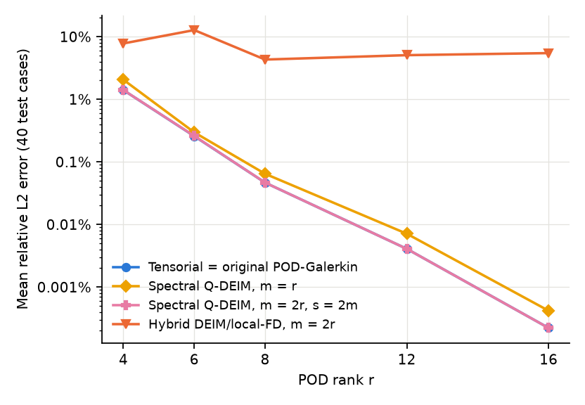 Figure 1. Error vs POD rank. | 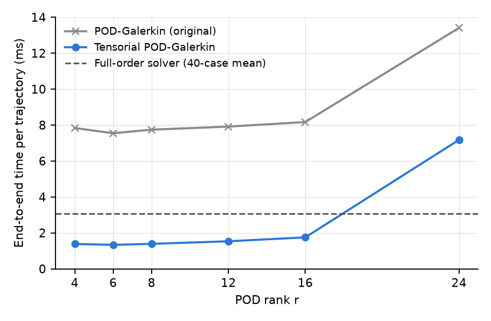 Figure 2. Runtime vs POD rank. |
| 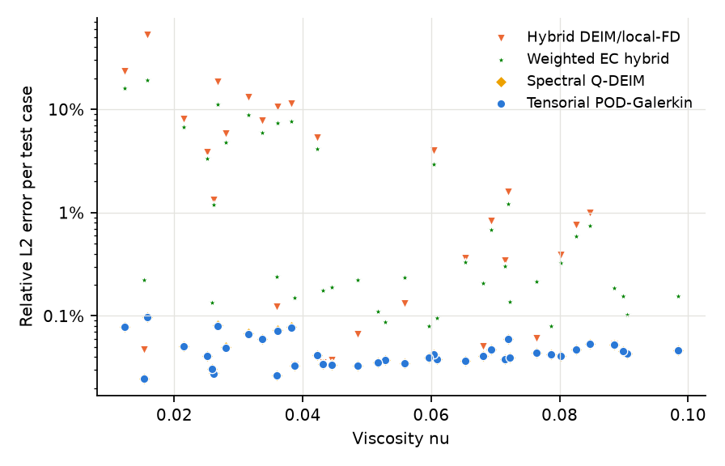 Figure 3. Error vs viscosity (test). | 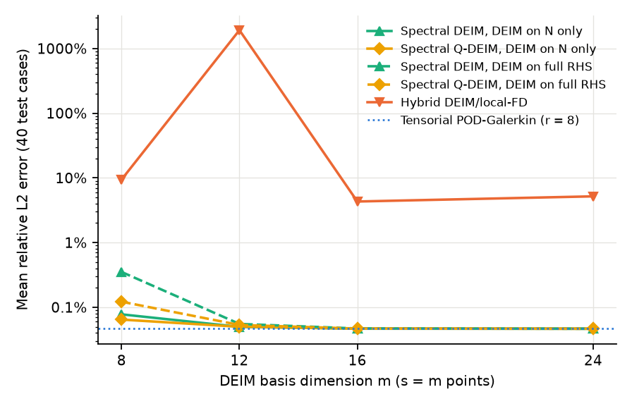 Figure 4. Error vs DEIM dimension m. |
| 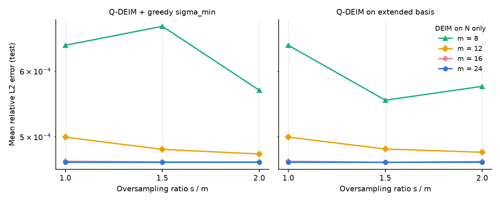 Figure 5. Error vs oversampling ratio. | 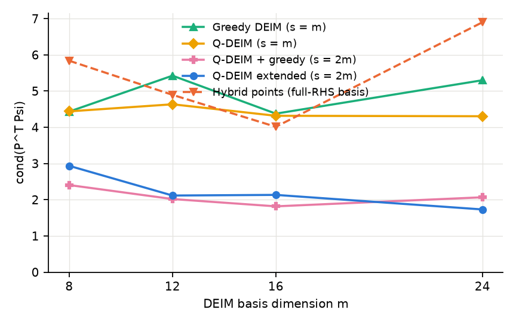 Figure 6. cond(P^T Psi). |
| 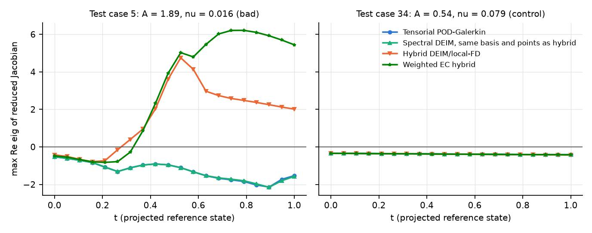 Figure 7. Max Re eig of the reduced Jacobian. | 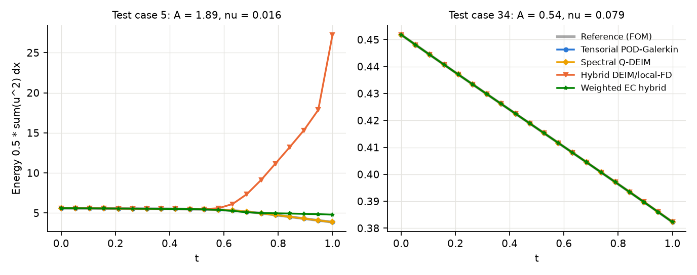 Figure 8. Energy evolution. |
| 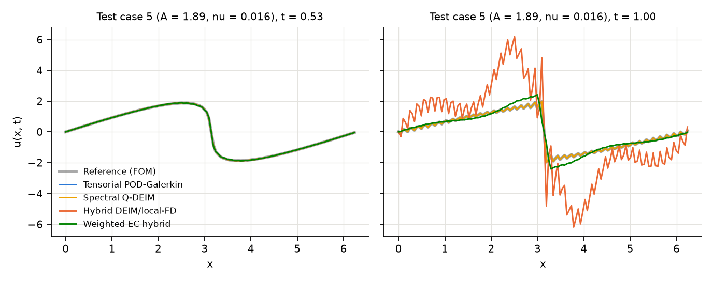 Figure 9. Predicted vs reference, case 5. | 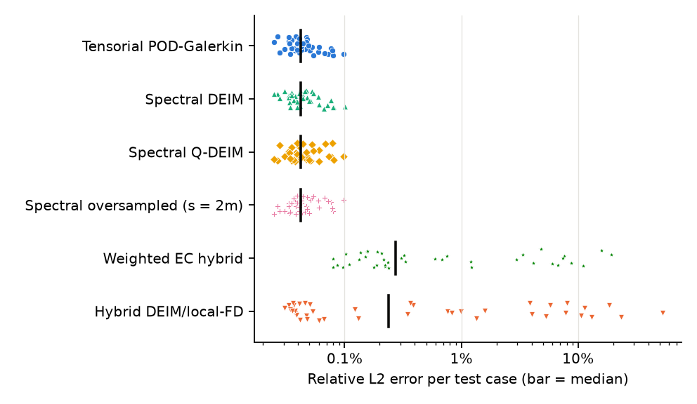 Figure 10. Per-case error distribution. |
| 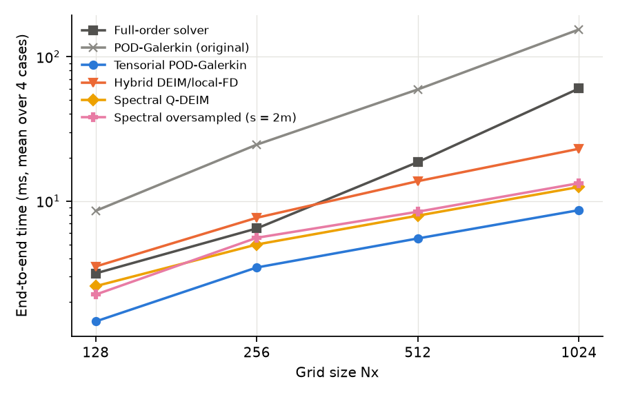 Figure 11. Runtime vs Nx. | 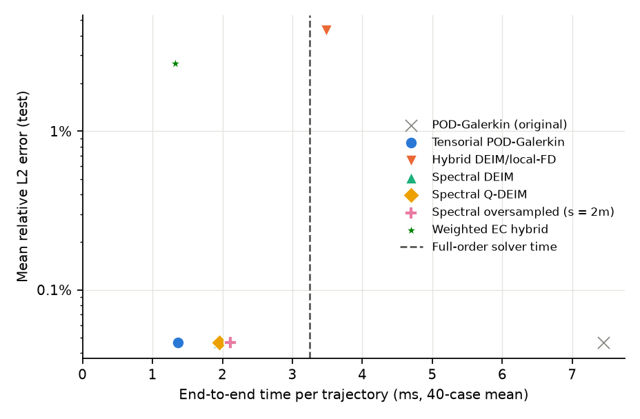 Figure 12. Accuracy vs runtime. |

---

## 8. Answers to the research questions

1. **Does tensorial POD reproduce the original POD-Galerkin dynamics?** Yes. It is an exact algebraic
   rewrite of the same discrete vector field; RHS agreement to 4e-14 and trajectory agreement to 4e-16
   (r = 4 to 16), the level of a machine-epsilon perturbation of a0. *Established.*
2. **Is tensorial POD faster than the full-order solver?** Yes on this machine: 2.38x end to end at
   Nx = 128 (2.37x in a repeat run; 1.77x to 3.79x per case) and 7.0x at Nx = 1024 (four cases).
   *Established for this hardware and NumPy 1.26.4*; the Nx = 128 ratio depends on the FFT library.
3. **Does spectral-consistent DEIM eliminate the local-FD instability?** Yes for every configuration
   tested (48 configurations at r = 8 on 80 cases, no case above 1.3%; ranks 4 to 16 with Q-DEIM,
   errors within 1% of tensorial POD's for m = 2r and up to 2x for m = r): no unstable case, negative Jacobian spectra where the hybrid's are positive. *Established for this problem family.*
4. **Does Q-DEIM improve conditioning or accuracy?** Conditioning slightly (equal or lower in 7 of 8
   settings), accuracy only at the smallest m = 8; from m = 12 it is equivalent to greedy DEIM.
5. **Does oversampling improve robustness?** It halves cond(P^T Psi) and helps at m = 8, not
   monotonically; nothing remains to be gained at m >= 16. Robustness was already complete without it.
6. **Does any DEIM variant outperform tensorial POD?** No, neither in accuracy nor in speed, and for a
   quadratic nonlinearity with s >= r it cannot do so in cost (Section 4.4).
7. **Are the improvements consistent across viscosity?** Yes: tensorial and spectral DEIM errors are
   flat in nu over [0.01, 0.1] and at nu = 0.15; the hybrid's failures are all at nu < 0.06.
8. **Best accuracy-versus-runtime trade-off?** Tensorial POD-Galerkin: lowest error among the reduced
   models (equal to the original ROM) and the lowest runtime (Figure 12). The post-hoc WEC hybrid is
   equally fast but 57 times less accurate.
9. **Remaining limitations**: see Section 9.
10. **Established versus hypothesis.** Established by these experiments: items 1 to 8 within the
    stated scope; the attribution of the hybrid's error to local-FD sampling; the negative result of
    the Frobenius energy correction. Hypotheses: the r = 24 slowdown being a cache effect; DEIM regaining
    an advantage at larger r or for non-polynomial nonlinearities; that a reduced-system step-size rule
    without the full-grid advective bound would scale better with Nx.

**Recommendation.** For this solver and problem family, replace the original POD-Galerkin online
stage by the tensorial form: it is the same model, about 5.5x faster, and faster than the full-order
solver. Spectral-consistent DEIM is the correct way to hyper-reduce the spectral model if DEIM is
wanted (it fixes the hybrid's instability), but it offers no advantage over the exact tensor for a
quadratic nonlinearity. The hybrid DEIM/local-FD model should not be used for steep, low-viscosity
cases at Nx = 128.

---

## 9. Limitations and future work

* One PDE, one solution family (A sin x, A in [0.5, 2], nu in [0.01, 0.1]), 1D, periodic. The
  tensorial argument needs a polynomial nonlinearity; cubic or non-polynomial terms change the
  cost comparison with DEIM.
* Errors are measured against the Nx = 128 discrete model, which itself differs from a resolved
  solution by up to 3.9% on the steepest cases (Section 6.4).
* Timing is from one laptop (Apple M3 Pro) shared with other workloads, in Python/NumPy, where call
  overhead dominates small-matrix work; the Nx = 128 speed-ups depend on the FFT library version.
  Scaling results use four cases per resolution.
* The inherited step-size policy keeps the full-order advective bound, so reduced step counts grow
  with Nx; the hyper-reduced models' per-step cost is Nx-independent but their runtime is not.
* r^3 storage and work: at r = 24 a mat-vec slowdown was observed and not investigated.
* The variance-weighted energy-conserving correction was designed after observing the unweighted
  result and evaluated on the same cases; a fresh held-out evaluation would be needed to claim it.
* Not re-run: the MLP and FNO (context only, historical protocol).

Suggested next experiments: a reduced-system step-size rule based on the frozen-Jacobian RK4 limit
(with the same pre-registered validation-then-test design as the earlier step-rule study); an
integrating-factor or exponential integrator for the linear term nu L of the tensorial model; a
resolution study against an Nx = 1024 reference; tensorial models for higher ranks with structured
(symmetric-storage) contractions; extension to a 2D quadratic problem.

---

## 10. Implementation summary

| File | Content |
|---|---|
| `src/tensorial_pod.py` | operator G, mode-product images, Q and L, quadratic RHS and Jacobian, RK4 driver, solver-only and end-to-end interfaces |
| `src/spectral_deim.py` | N-snapshots, DEIM / Q-DEIM / oversampled point selection, least-squares (P^T Psi)^+, sampled tensors C and D_s, the two DEIM targets, folding, solver-only and end-to-end interfaces |
| `src/energy_conserving.py` | Sym(Q), Frobenius and variance-weighted energy-conserving projections, energy diagnostics, exact folding of the hybrid local-FD model |
| `scripts/tensorial_deim_study.py` | all experiment stages (Section 13) |
| `scripts/plot_tensorial_deim_study.py` | Figures 1 to 12 |
| `tests/test_tensorial_pod.py` (24), `tests/test_spectral_deim.py` (28), `tests/test_energy_conserving.py` (11) | see Section 11 |

`src/solver.py`, `src/pod_rom.py`, `src/deim.py`, `src/timestep.py`, the data files and every
historical result file are unchanged.

## 11. Tests

Full suite: **179 passed, 1 skipped** under NumPy 1.26.4 (116 existing + 63 new; the skip is `tests/test_device.py`'s no-MPS failure-path check, which runs only on machines without Apple MPS), in
about 13 s, offline, CPU only, deterministic. New tests cover tensor construction and symmetry,
RHS equivalence (r = 2 to 12, odd Nx), the analytic Jacobian, absence of online FFTs, trajectory
equivalence under both step policies and aligned snapshots, the float32 first-stage effect, mass
conservation, step-count agreement, reproducibility; sampled-operator equivalence (including both ends
of the periodic grid and odd Nx), interpolation exactness for s = m and s > m, least-squares optimality,
Q-DEIM pivots, greedy oversampling monotonicity and determinism, the two exactness limits, the two
DEIM targets; energy-conserving projections (zero cubic form, symmetry, idempotence, orthogonality,
weighted optimality, energy non-increase along a trajectory) and exact folding of the hybrid model
for stencil orders 2 and 4.

**NumPy versions.** All reported numbers were produced with NumPy 1.26.4. NumPy 2 transforms float32
input in single precision; since the stored basis is float32, the reduced Laplacian L is built from a
float64 copy of the basis so that it does not depend on the NumPy version (under NumPy 1.26.4 this is
bit-identical to the original computation, and every per-case error is unchanged). The new modules'
tests and the existing NumPy-only tests also pass under NumPy 2.4.6 / SciPy 1.17.1, the versions the
repository's CI installs from the unpinned `requirements.txt`.

## 12. Data and protocol notes

Datasets were not regenerated: `data/{train,val,test}.npz` and `data/ood_family_test.npz` are used as
stored; aligned references are recomputed deterministically with the repository's solvers (as the
earlier audit did). Bases for Nx > 128 come from the first 100 historical training parameters. No
random choice enters the evaluation except seeded test states and perturbation directions.

## 13. Reproduction

```bash
uv venv --python 3.11 .venv && uv pip install --python .venv/bin/python -r requirements-lock.txt
# data/*.npz as produced by scripts/generate_dataset.py and scripts/generate_ood_dataset.py;
# experiments/deim_basis.npz from scripts/build_deim.py
for s in baseline equivalence tensorial_bench spectral_consistency deim_sweep stability \
         comparison sensitivity scaling reference_resolution; do
  .venv/bin/python scripts/tensorial_deim_study.py $s --tag run1
done
VECLIB_MAXIMUM_THREADS=1 OMP_NUM_THREADS=1 .venv/bin/python scripts/tensorial_deim_study.py comparison --tag run2_1thread
.venv/bin/python scripts/plot_tensorial_deim_study.py
.venv/bin/python -m pytest -q tests
```

Run time on the machine above: about 15 minutes for all stages, dominated by `scaling`. Accuracy
results are deterministic; timings vary by a few percent between runs.
